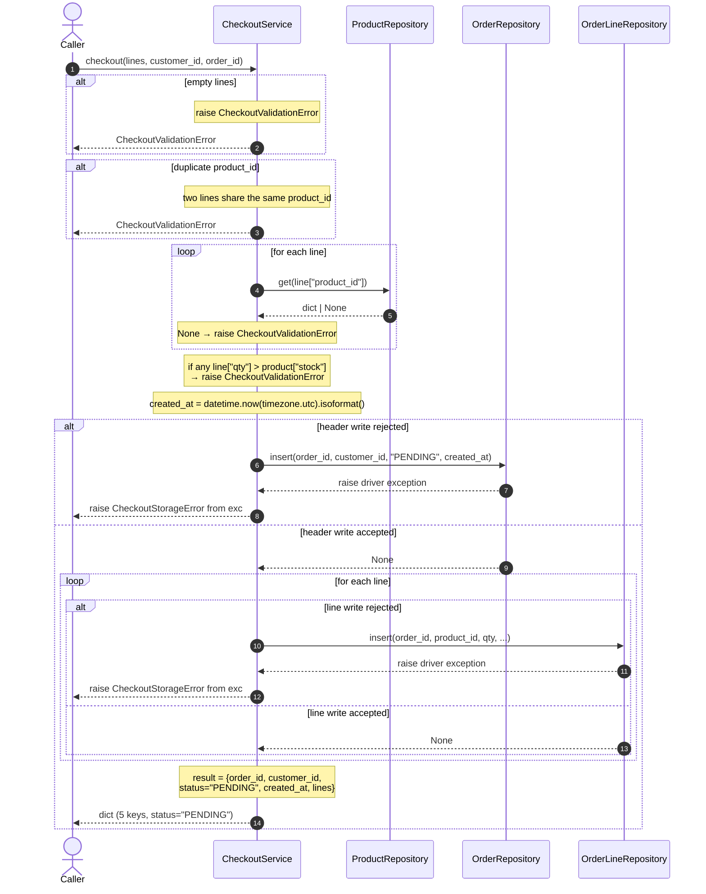

# Task

- task_id: 004_checkout_service
- target_file: services/checkout.py
- target_test_file: services/checkout_test.py

# Goal

Turn a list of order lines into a persisted order; plain-dict API. The service depends on narrow contracts for its three repositories, not on the concrete classes. The service produces the order timestamp itself via `datetime.now(timezone.utc).isoformat()` — the caller does not supply a clock.

# Declares

- CheckoutService
- ProductRepository
- OrderRepository
- OrderLineRepository
- CheckoutError
- CheckoutValidationError
- CheckoutStorageError

# Interfaces

```python
class ProductRepository(Protocol):
    """The narrow product-repository port the checkout slice reads through.

    Description:
        Narrow structural contract for the product repository.
        The port is read-only — it declares only the lookup
        operation.

    Steps:
        1. Declare the get operation.
    """

    def get(self, product_id: str) -> dict | None:
        """Return the product with the given id, or None.

        Description:
            Look up one product by primary key. A missing row is
            a valid outcome — return None when no product matches
            product_id.

        Steps:
            1. Read the product row whose primary key equals
               product_id.
            2. Return the row as a mapping with exactly five
               keys — product_id, name, price_amount,
               price_currency, stock — or None.

        Returns:
            dict | None: A dict with exactly five keys, or None.
        """
        ...
```

```python
class OrderRepository(Protocol):
    """The narrow order-header-repository port the checkout slice writes through.

    Description:
        Narrow structural contract for the order header
        repository. The port is write-only — it declares only
        the insert operation, no read-back.

    Steps:
        1. Declare the insert operation.
    """

    def insert(
        self,
        order_id: str,
        customer_id: str,
        status: str,
        created_at: str,
    ) -> None:
        """Insert one order header row.

        Description:
            Persist one order with the four header fields. Any
            storage rejection propagates unchanged; the caller
            (CheckoutService) wraps it in CheckoutStorageError.

        Steps:
            1. Persist one order row with the four header fields.
            2. Let any storage rejection propagate unchanged.
            3. Return None.
        """
        ...
```

```python
class OrderLineRepository(Protocol):
    """The narrow order-line-repository port the checkout slice writes through.

    Description:
        Narrow structural contract for the order line repository.
        The port is write-only — it declares only the insert
        operation, no read-back.

    Steps:
        1. Declare the insert operation.
    """

    def insert(
        self,
        order_id: str,
        product_id: str,
        qty: int,
        unit_amount: str,
        unit_currency: str,
    ) -> None:
        """Insert one order line row.

        Description:
            Persist one line associated with the given order. Any
            storage rejection propagates unchanged; the caller
            (CheckoutService) wraps it in CheckoutStorageError.

        Steps:
            1. Persist one line row with the five fields.
            2. Let any storage rejection propagate unchanged.
            3. Return None.
        """
        ...
```

```python
class CheckoutError(Exception):
    """Base class for every error raised by the checkout service.

    Description:
        Common superclass for every exception the checkout
        service raises. Declared here, in services.checkout.
        Imported by routers.orders; never redeclared there.

    Steps:
        1. Inherit from Exception.
    """
```

```python
class CheckoutValidationError(CheckoutError):
    """Raised when a request fails validation before any storage write.

    Description:
        Raised when the lines list is empty, two lines share the
        same product_id, a line references a missing product, or
        a line's quantity exceeds its product's stock. The order
        store is untouched when this is raised. Declared here, in
        services.checkout. Imported by routers.orders; never
        redeclared there.

    Steps:
        1. Inherit from CheckoutError.
    """
```

```python
class CheckoutStorageError(CheckoutError):
    """Raised when the underlying store rejects a write.

    Description:
        Raised when the order repository or the order line
        repository rejects a write — a primary key conflict, a
        foreign key violation, or a constraint failure. The
        original driver exception is preserved on the
        ``__cause__`` attribute via ``raise ... from exc``.
        Declared here, in services.checkout. Imported by
        routers.orders; never redeclared there.

    Steps:
        1. Inherit from CheckoutError.
    """
```

```python
class CheckoutService:
    """Turn a list of order lines into a persisted order; holds no connection.

    Description:
        Service layer for checkout. Validates a list of order
        lines against product stock, then persists the order
        header and every line through the order and order-line
        repositories. The result is assembled from the values
        written, not read back from storage. Every failure is
        raised as a typed subclass of CheckoutError — never as
        a bare ValueError, KeyError, or sqlite3 exception.

        The order timestamp is produced INSIDE checkout via
        ``datetime.now(timezone.utc).isoformat()``. The caller
        does not supply a clock and cannot override the time
        source — the produced timestamp is whatever the system
        clock returns at the moment `checkout` runs.

    Steps:
        1. Store the three injected repositories on the instance.
        2. Expose checkout.
    """

    def __init__(
        self,
        products: ProductRepository,
        orders: OrderRepository,
        lines: OrderLineRepository,
    ) -> None:
        """Wrap three repositories.

        Description:
            Store every dependency on the instance so checkout
            can delegate to them.

        Steps:
            1. Store the product repository on the instance.
            2. Store the order header repository on the instance.
            3. Store the order line repository on the instance.
            4. Return None.
        """
        ...

    def checkout(
        self,
        lines: list[dict],
        customer_id: str,
        order_id: str,
    ) -> dict:
        """Turn a list of order lines into a persisted order.

        Description:
            Validate the whole lines list before touching any
            repository, so a validation failure leaves the order
            store untouched. On success, persist the order header
            and every line, one write per repository call. Return
            a mapping assembled from the values written —
            order_id, customer_id, status "PENDING", created_at
            produced internally from the current UTC time, and
            the input lines list. Every failure is raised as a
            typed subclass of CheckoutError — never as a bare
            ValueError, KeyError, or sqlite3 exception.

        Steps:
            1. Raise CheckoutValidationError when the lines list
               is empty, before any repository call.
            2. Raise CheckoutValidationError when any two lines
               share the same product_id — this check runs before
               the product repository is touched.
            3. Look up the product for each line through the
               product repository; raise CheckoutValidationError
               when no product matches.
            4. Raise CheckoutValidationError when any line's
               quantity exceeds its product's stock.
            5. Produce created_at via
               ``datetime.now(timezone.utc).isoformat()``.
            6. Persist the order header through the order
               repository. If the repository raises, wrap the
               original exception in CheckoutStorageError via
               ``raise CheckoutStorageError(...) from exc`` and
               let the wrapper propagate.
            7. Persist every line through the order line
               repository, in the input order. If the repository
               raises, wrap the original exception in
               CheckoutStorageError via ``raise
               CheckoutStorageError(...) from exc`` and let the
               wrapper propagate.
            8. Return a dict with exactly five keys — order_id,
               customer_id, status "PENDING", created_at from
               step 5, lines from the input lines list.

        Returns:
            dict: A dict with exactly five keys — order_id,
                customer_id, status, created_at, lines — where
                status is "PENDING".

        Raises:
            CheckoutValidationError: When the request fails
                validation — empty lines, duplicate product_id,
                missing product, or insufficient stock. The order
                store is untouched.
            CheckoutStorageError: When the order or order line
                repository rejects a write. The original driver
                exception is preserved on ``__cause__``.
        """
        ...
```

# Sequence



# Gherkins

## CheckoutService: checkout persists order and lines

```gherkin
Given an empty shop store with the schema applied
And a product with id "p1" and stock 10 is persisted
And a checkout service over the repositories
And one line for product "p1" with qty 1, unit_amount "10.00", unit_currency "USD"
When checkout is called for customer "c1" and order "o1"
Then the returned mapping has exactly five keys
And its status is "PENDING"
And its created_at is a non-empty ISO-8601 string with a timezone offset
And its lines have one element for product "p1"
And the order header "o1" is persisted
And the line for product "p1" is persisted under order "o1" with qty 1, unit_amount "10.00", unit_currency "USD"
```

## CheckoutService: empty lines raises CheckoutValidationError

```gherkin
Given an empty shop store with the schema applied
And a checkout service over the repositories
When checkout is called with an empty lines list
Then it raises CheckoutValidationError
And the order store is untouched
```

## CheckoutService: missing product raises CheckoutValidationError

```gherkin
Given an empty shop store with the schema applied
And no product with id "p1" is persisted
And a checkout service over the repositories
When checkout is called with one line for product "p1"
Then it raises CheckoutValidationError
And the order store is untouched
```

## CheckoutService: insufficient stock raises CheckoutValidationError

```gherkin
Given an empty shop store with the schema applied
And a product with id "p1" and stock 2 is persisted
And a checkout service over the repositories
When checkout is called with one line for product "p1" and qty 5
Then it raises CheckoutValidationError
And the order store is untouched
```

## CheckoutService: duplicate product raises CheckoutValidationError

```gherkin
Given an empty shop store with the schema applied
And a product with id "p1" and stock 10 is persisted
And a checkout service over the repositories
When checkout is called with two lines both for product "p1"
Then it raises CheckoutValidationError
And the order store is untouched
And the product repository was never queried
```

## CheckoutService: header storage rejection raises CheckoutStorageError

```gherkin
Given an empty shop store with the schema applied
And a product with id "p1" and stock 10 is persisted
And an order repository that raises a storage exception on insert
And a checkout service over the repositories
And one line for product "p1" with qty 1, unit_amount "10.00", unit_currency "USD"
When checkout is called for customer "c1" and order "o1"
Then it raises CheckoutStorageError
And the raised exception's __cause__ is the original storage exception
```

## CheckoutService: line storage rejection raises CheckoutStorageError

```gherkin
Given an empty shop store with the schema applied
And a product with id "p1" and stock 10 is persisted
And an order line repository that raises a storage exception on insert
And a checkout service over the repositories
And one line for product "p1" with qty 1, unit_amount "10.00", unit_currency "USD"
When checkout is called for customer "c1" and order "o1"
Then it raises CheckoutStorageError
And the raised exception's __cause__ is the original storage exception
```

## CheckoutService: storage error is a subclass of CheckoutError, not validation

```gherkin
Given an empty shop store with the schema applied
And a product with id "p1" and stock 10 is persisted
And an order repository that raises a storage exception on insert
And a checkout service over the repositories
And one line for product "p1" with qty 1, unit_amount "10.00", unit_currency "USD"
When checkout is called for customer "c1" and order "o1"
Then the raised exception is a CheckoutStorageError
And the raised exception is a CheckoutError
And the raised exception is not a CheckoutValidationError
```