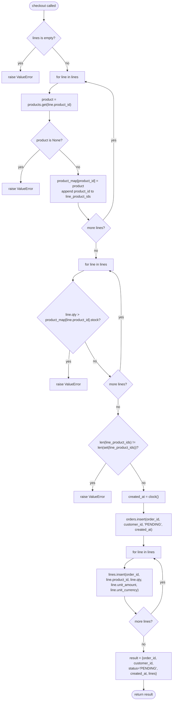
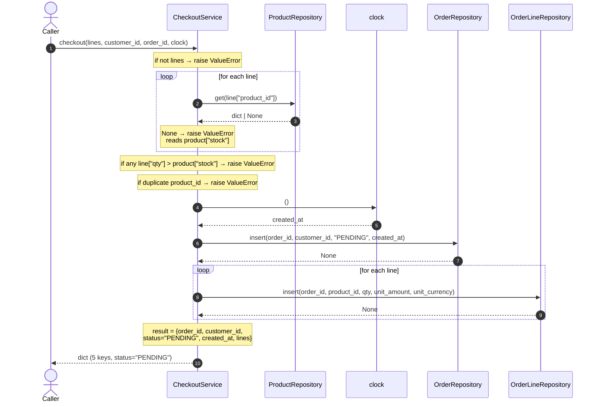

# Task

- task_id: 004_checkout_service
- target: services/checkout.py
- target_test: services/checkout_test.py

# Goal

Define `CheckoutService` — turn a list of order lines into a persisted order; plain-dict API. The service depends on structural protocols for its three repositories, not on the concrete classes.

# Interfaces

```python
class ProductRepository(Protocol):
    """The product repository operations CheckoutService depends on.

    Description:
        Narrow structural contract for the product repository.
        Checkout only reads products — it never writes them — so
        this protocol declares only the lookup operation.

    Steps:
        1. Declare the get operation.
    """

    def get(self, product_id: str) -> dict | None:
        """Return the product with the given id, or None.

        Description:
            Look up one product by primary key. Missing rows are
            not an error. Checkout uses this to validate that
            every line references an existing product and to read
            its stock.

        Steps:
            1. Read the product row whose primary key equals
               product_id.
            2. Return the row as a mapping with exactly five
               keys — product_id, name, price_amount,
               price_currency, stock — or None.

        Returns:
            dict | None: A dict with exactly five keys, or None.
        """
        ...
```

```python
class OrderRepository(Protocol):
    """The order header repository operations CheckoutService depends on.

    Description:
        Narrow structural contract for the order header
        repository. Checkout only writes the header — it never
        reads it back — so this protocol declares only the insert
        operation.

    Steps:
        1. Declare the insert operation.
    """

    def insert(
        self,
        order_id: str,
        customer_id: str,
        status: str,
        created_at: str,
    ) -> None:
        """Insert one order header row.

        Description:
            Persist one order with the four header fields. Any
            constraint violation propagates unchanged.

        Steps:
            1. Persist one order row with the four header fields.
            2. Return None.

        Raises:
            sqlite3.IntegrityError: On duplicate order_id or any
                other constraint violation. Propagated unchanged.
        """
        ...
```

```python
class OrderLineRepository(Protocol):
    """The order line repository operations CheckoutService depends on.

    Description:
        Narrow structural contract for the order line repository.
        Checkout only writes lines — it never reads them back —
        so this protocol declares only the insert operation.

    Steps:
        1. Declare the insert operation.
    """

    def insert(
        self,
        order_id: str,
        product_id: str,
        qty: int,
        unit_amount: str,
        unit_currency: str,
    ) -> None:
        """Insert one order line row.

        Description:
            Persist one line associated with the given order. Any
            constraint violation propagates unchanged.

        Steps:
            1. Persist one line row with the five fields.
            2. Return None.

        Raises:
            sqlite3.IntegrityError: On duplicate (order_id,
                product_id), on unknown order_id, on unknown
                product_id, or any other constraint violation.
                Propagated unchanged.
        """
        ...
```

```python
class CheckoutService:
    """Turns a list of order lines into a persisted order; holds no connection and no clock of its own.

    Description:
        Service layer for checkout. Validates a list of order
        lines against product stock, then persists the order
        header and every line through the order and order-line
        repositories. The result is assembled from the values
        written, not read back from storage.

    Steps:
        1. Store the three injected repositories on the instance.
        2. Expose checkout.
    """

    def __init__(
        self,
        products: ProductRepository,
        orders: OrderRepository,
        lines: OrderLineRepository,
    ) -> None:
        """Wrap three repositories.

        Description:
            Store every dependency on the instance so checkout
            can delegate to them.

        Steps:
            1. Store the product repository on the instance.
            2. Store the order header repository on the instance.
            3. Store the order line repository on the instance.
            4. Return None.
        """
        ...

    def checkout(
        self,
        lines: list[dict],
        customer_id: str,
        order_id: str,
        clock: Callable[[], str],
    ) -> dict:
        """Turn a list of order lines into a persisted order.

        Description:
            Validate the whole lines list before touching any
            repository, so a failure leaves the order store
            untouched. On success, persist the order header and
            every line, one write per repository call. Return a
            mapping assembled from the values written — order_id,
            customer_id, status "PENDING", created_at from the
            clock, and the input lines list.

        Steps:
            1. Reject an empty lines list as the first action,
               before any repository call.
            2. Look up every line's product through the product
               repository; a missing product is an error.
            3. Reject the request when any line's quantity
               exceeds its product's stock.
            4. Reject the request when any two lines in the input
               share the same product_id.
            5. Read created_at from the clock.
            6. Persist the order header through the order
               repository.
            7. Persist every line through the order line
               repository, in the input order.
            8. Return a dict with exactly five keys — order_id,
               customer_id, status "PENDING", created_at from
               step 5, lines from the input lines list.

        Returns:
            dict: A dict with exactly five keys — order_id,
                customer_id, status, created_at, lines — where
                status is "PENDING".

        Raises:
            ValueError: When the lines list is empty.
            ValueError: When any line references a missing product.
            ValueError: When any line's quantity exceeds its
                product's stock.
            ValueError: When two lines share the same product_id.
            sqlite3.IntegrityError: Whatever the order or order
                line repository raises when persisting.
        """
        ...
```

# Activity



# Sequence



# Scenarios

## checkout persists order and lines

```gherkin
Given an empty shop store with the schema applied
And a product with id "p1" and stock 10 is persisted
And a checkout service over the repositories
And one line for product "p1" with qty 1, unit_amount "10.00", unit_currency "USD"
And a clock that returns "2024-01-01T00:00:00+00:00"
When checkout is called for customer "c1" and order "o1"
Then the returned mapping has exactly five keys
And its status is "PENDING"
And its created_at is "2024-01-01T00:00:00+00:00"
And its lines have one element for product "p1"
And the order header "o1" is persisted
And the line for product "p1" is persisted under order "o1" with qty 1, unit_amount "10.00", unit_currency "USD"
```