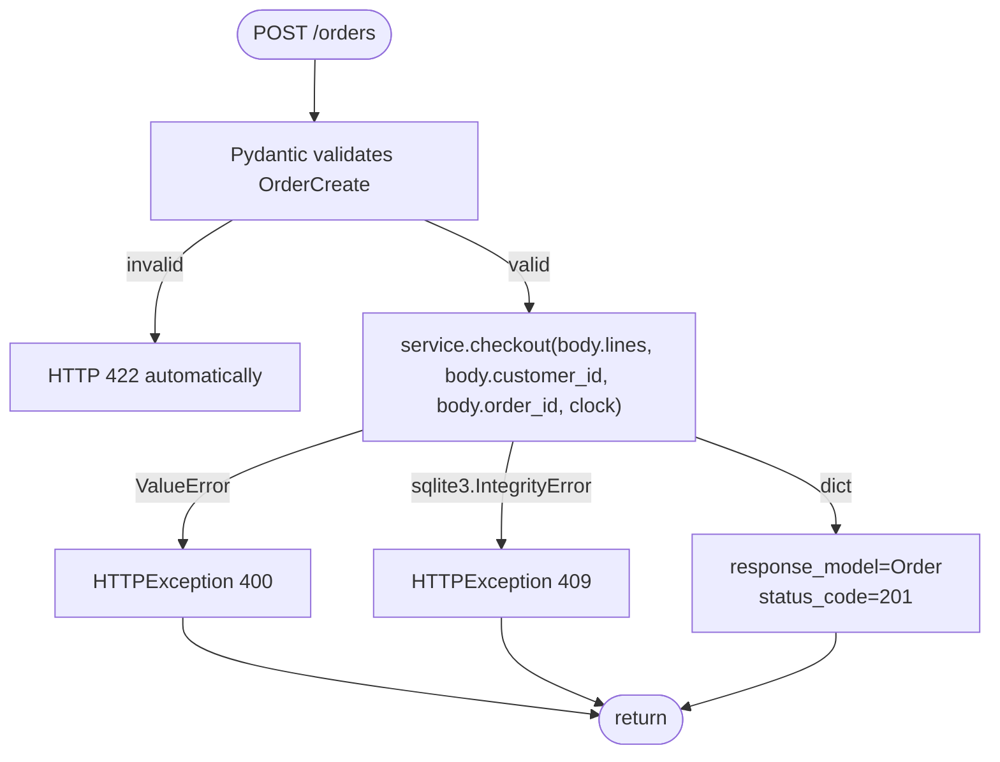
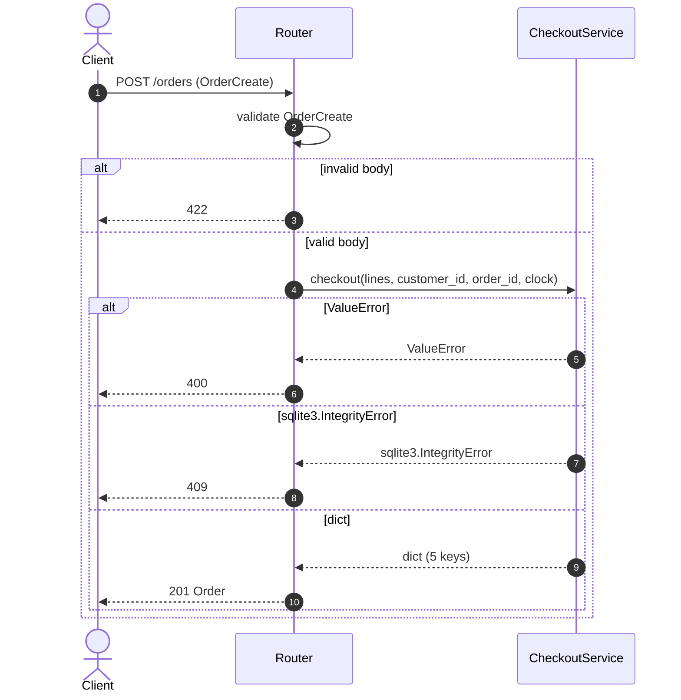

# Task

- task_id: 005_orders_router
- target: routers/orders.py
- target_test: routers/orders_test.py

# Goal

Define the orders models and the `make_orders_router` factory: one create endpoint that calls `CheckoutService.checkout` and maps value errors to 400, storage integrity errors to 409.

# Interfaces

```python
class CheckoutService(Protocol):
    """The checkout service operation make_orders_router depends on.

    Description:
        Narrow structural contract for the checkout service.
        The orders router only creates orders — no reads, no
        status transitions — so this protocol declares only the
        checkout operation.

    Steps:
        1. Declare the checkout operation.
    """

    def checkout(
        self,
        lines: list[dict],
        customer_id: str,
        order_id: str,
        clock: Callable[[], str],
    ) -> dict:
        """Turn a list of order lines into a persisted order.

        Description:
            Validate the whole lines list before touching any
            repository. On success, the persisted order is
            returned with status PENDING and the input lines
            attached.

        Steps:
            1. Reject an empty lines list before any repository
               call.
            2. Look up every line's product; a missing product
               is an error.
            3. Reject when any line's quantity exceeds its
               product's stock.
            4. Reject when any two lines share the same
               product_id.
            5. Read created_at from the clock.
            6. Persist the order and every line.
            7. Return a dict with five keys — order_id,
               customer_id, status "PENDING", created_at, lines.

        Returns:
            dict: A dict with exactly five keys — order_id,
                customer_id, status, created_at, lines.

        Raises:
            ValueError: When the lines list is empty.
            ValueError: When any line references a missing
                product.
            ValueError: When any line's quantity exceeds its
                product's stock.
            ValueError: When two lines share the same
                product_id.
            sqlite3.IntegrityError: Whatever the storage raises
                when persisting.
        """
        ...
```

```python
class OrderStatus(StrEnum):
    """Lifecycle status of an order; closed set of four allowed values.

    Description:
        Closed enumeration of the four allowed order statuses.
        The wire form of each value is the plain string of its
        name in upper case.
    """

    PENDING = "PENDING"
    PAID = "PAID"
    SHIPPED = "SHIPPED"
    CANCELLED = "CANCELLED"
```

```python
class OrderLine(BaseModel):
    """Response model for one order line; immutable, closed to unknown fields.

    Description:
        Response shape of one order line. Carries four fields:
        product_id, qty, unit_amount, unit_currency. Immutable
        after construction. Closed to unknown fields. Also used
        as the request-model line shape.

    Steps:
        1. Declare four fields with title, description, example.
        2. qty is constrained to be strictly positive.
        3. Reject unknown fields on construction.
        4. Freeze instances after construction.
    """

    model_config = ConfigDict(extra="forbid", frozen=True)

    product_id: str = Field(...)
    qty: int = Field(..., gt=0)
    unit_amount: str = Field(...)
    unit_currency: str = Field(...)
```

```python
class Order(BaseModel):
    """Response model for one order; immutable, closed to unknown fields.

    Description:
        Response shape of one order. Carries five fields:
        order_id, customer_id, status, created_at, lines.
        status is typed as OrderStatus. lines is a list of
        OrderLine. Immutable after construction. Closed to
        unknown fields.
    """

    model_config = ConfigDict(extra="forbid", frozen=True)

    order_id: str = Field(...)
    customer_id: str = Field(...)
    status: OrderStatus = Field(...)
    created_at: str = Field(...)
    lines: list[OrderLine] = Field(...)
```

```python
class OrderCreate(BaseModel):
    """Request body for creating an order; carries only what the client chooses.

    Description:
        Request shape accepted by the create endpoint. Carries
        three fields: customer_id, order_id, lines. status and
        created_at are absent — the service sets them, not the
        client. Closed to unknown fields.
    """

    model_config = ConfigDict(extra="forbid")

    customer_id: str = Field(...)
    order_id: str = Field(...)
    lines: list[OrderLine] = Field(...)
```

```python
def make_orders_router(
    service: CheckoutService,
    clock: Callable[[], str],
) -> APIRouter:
    """Build the orders router closed over the given checkout service and clock.

    Description:
        Register one create endpoint at POST / with prefix
        /orders and tag orders. A value error maps to 400 Bad
        Request; a storage integrity error maps to 409 Conflict.
        Every HTTP status code is a named constant.

    Steps:
        1. Create the router with prefix /orders and tag orders.
        2. Register POST / . Input is OrderCreate; output is
           Order; respond with 201 Created. A value error maps
           to 400 Bad Request; a storage integrity error maps
           to 409 Conflict.
        3. Return the router.

    Returns:
        APIRouter: A router with the create endpoint registered.
    """
    ...
```

# Activity



# Sequence



# Scenarios

## create returns 201

```gherkin
Given an empty shop store with the schema applied
And a product with id "p1" and stock 10 is persisted
And a test client over the orders router
When a valid create request is sent for customer "c1" and order "o1" with one line for "p1"
Then the response status is 201
And the body's status is "PENDING"
```

## create with empty lines returns 400

```gherkin
Given an empty shop store with the schema applied
And a test client over the orders router
When a create request is sent with an empty lines list
Then the response status is 400
```

## create with missing product returns 400

```gherkin
Given an empty shop store with the schema applied
And a test client over the orders router
When a create request is sent with a line for an unknown product
Then the response status is 400
```

## create with duplicate order returns 409

```gherkin
Given an empty shop store with the schema applied
And a product with id "p1" is persisted
And an order with id "o1" is persisted directly
And a test client over the orders router
When a create request is sent for the same order id "o1"
Then the response status is 409
```