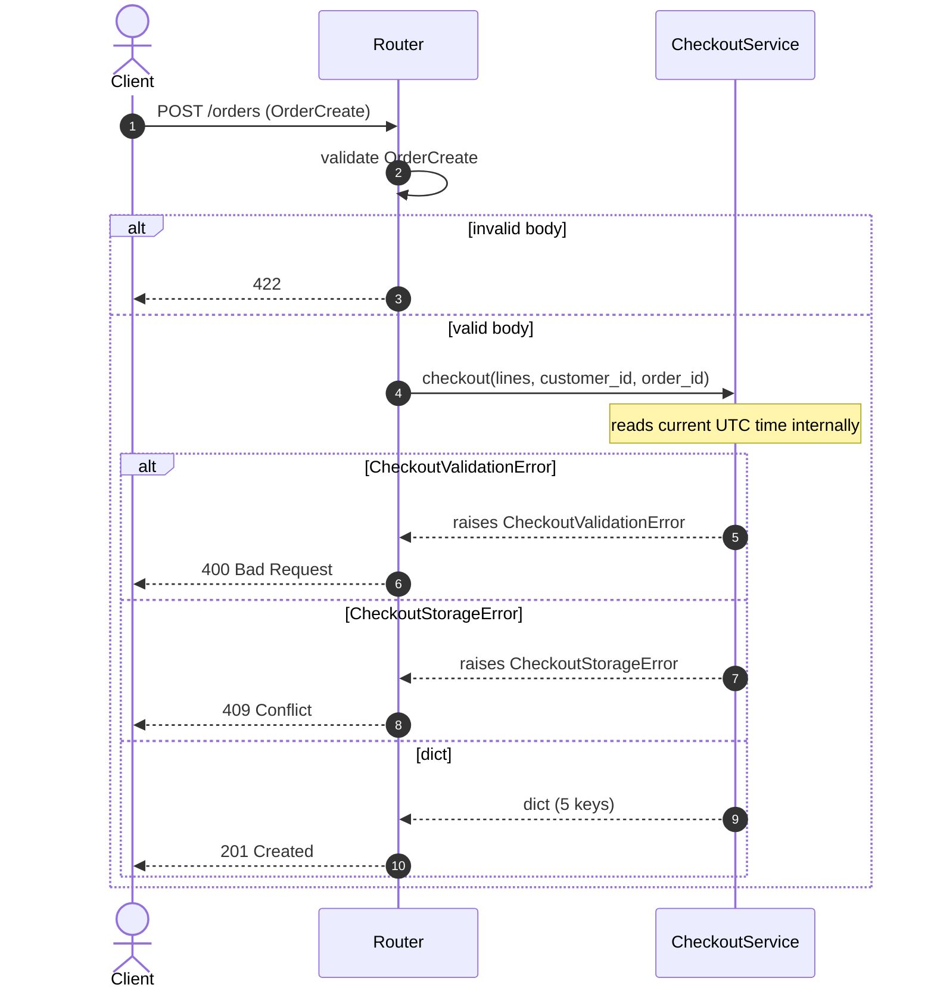

# Task

- task_id: 005_orders_router
- target_file: routers/orders.py
- target_test_file: routers/orders_test.py

# Goal

Build the orders HTTP surface: request and response models, and one create endpoint on POST /orders that delegates to the checkout operation. Map request rejection to 400, storage rejection to 409, success to 201. Every HTTP status code is a named constant from `fastapi.status`.

# Declares

- make_orders_router
- CheckoutService
- OrderStatus
- OrderLine
- Order
- OrderCreate

# Interfaces

```python
class CheckoutService(Protocol):
    """The checkout service operation make_orders_router depends on.

    Description:
        Narrow structural contract for the checkout service.
        The orders router only creates orders — no reads, no
        status transitions — so this protocol declares only the
        checkout operation. Failures are signalled through
        two typed subclasses of CheckoutError, so the router
        maps HTTP status codes by class, never by inspecting
        the exception message text.

    Steps:
        1. Declare the checkout operation.
    """

    def checkout(
        self,
        lines: list[dict],
        customer_id: str,
        order_id: str,
    ) -> dict:
        """Turn a list of order lines into a persisted order.

        Description:
            Validate the whole lines list before touching any
            repository. On success, the persisted order is
            returned with status PENDING and the input lines
            attached. The order timestamp is produced inside
            this operation from the current UTC time — the
            caller does not supply it. Every failure is raised
            as one of the two CheckoutError subclasses listed
            under Raises; the router dispatches on class, not
            on message text.

        Steps:
            1. Raise CheckoutValidationError when the lines
               list is empty, before any repository call.
            2. Look up every line's product; raise
               CheckoutValidationError when no product matches.
            3. Raise CheckoutValidationError when any line's
               quantity exceeds its product's stock.
            4. Raise CheckoutValidationError when any two lines
               share the same product_id.
            5. Read the current UTC time and format it as an
               ISO-8601 string with the timezone offset.
            6. Persist the order and every line. Wrap any
               repository failure in CheckoutStorageError via
               ``raise CheckoutStorageError(...) from exc``.
            7. Return a dict with five keys — order_id,
               customer_id, status "PENDING", created_at from
               step 5, lines from the input lines list.

        Returns:
            dict: A dict with exactly five keys — order_id,
                customer_id, status, created_at, lines.

        Raises:
            CheckoutValidationError: When the request fails
                validation — empty lines, missing product,
                insufficient stock, or duplicate product_id.
            CheckoutStorageError: When the storage layer
                rejects a write. The original driver exception
                is preserved on ``__cause__``.
        """
        ...
```

```python
class OrderStatus(StrEnum):
    """Lifecycle status of an order; closed set of four allowed values.

    Description:
        Closed enumeration of the four allowed order statuses.
        The wire form of each value is the plain string of its
        name in upper case.
    """

    PENDING = "PENDING"
    PAID = "PAID"
    SHIPPED = "SHIPPED"
    CANCELLED = "CANCELLED"
```

```python
class OrderLine(BaseModel):
    """Response model for one order line; immutable, closed to unknown fields.

    Description:
        Response shape of one order line. Carries four fields:
        product_id, qty, unit_amount, unit_currency. Immutable
        after construction. Closed to unknown fields. Also used
        as the request-model line shape.

    Steps:
        1. Declare four fields: product_id, qty, unit_amount,
           unit_currency.
        2. qty is constrained to be strictly positive.
        3. Reject unknown fields on construction.
        4. Freeze instances after construction.
    """

    model_config = ConfigDict(extra="forbid", frozen=True)

    product_id: str = Field(
        ...,
        title="Product ID",
        description="Identifier of the product this line references.",
    )
    qty: int = Field(
        ...,
        gt=0,
        title="Quantity",
        description="Number of units of the product; strictly positive.",
    )
    unit_amount: str = Field(
        ...,
        title="Unit amount",
        description="Price amount per unit, as a decimal string.",
    )
    unit_currency: str = Field(
        ...,
        title="Unit currency",
        description="Currency code of the unit amount, e.g. USD.",
    )
```

```python
class Order(BaseModel):
    """Response model for one order; immutable, closed to unknown fields.

    Description:
        Response shape of one order. Carries five fields:
        order_id, customer_id, status, created_at, lines.
        status is typed as OrderStatus. lines is a list of
        OrderLine. Immutable after construction. Closed to
        unknown fields.

    Steps:
        1. Declare five fields: order_id, customer_id, status,
           created_at, lines.
        2. Type status as OrderStatus.
        3. Type lines as a list of OrderLine.
        4. Reject unknown fields on construction.
        5. Freeze instances after construction.
    """

    model_config = ConfigDict(extra="forbid", frozen=True)

    order_id: str = Field(
        ...,
        title="Order ID",
        description="Identifier of the persisted order.",
    )
    customer_id: str = Field(
        ...,
        title="Customer ID",
        description="Identifier of the customer who placed the order.",
    )
    status: OrderStatus = Field(
        ...,
        title="Status",
        description="Lifecycle status of the order.",
    )
    created_at: str = Field(
        ...,
        title="Created at",
        description="ISO-8601 timestamp of the moment the order was persisted.",
    )
    lines: list[OrderLine] = Field(
        ...,
        title="Lines",
        description="Order lines persisted with this order, in input order.",
    )
```

```python
class OrderCreate(BaseModel):
    """Request body for creating an order; carries only what the client chooses.

    Description:
        Request shape accepted by the create endpoint. Carries
        three fields: customer_id, order_id, lines. status and
        created_at are absent — the service sets them, not the
        client. Closed to unknown fields.

    Steps:
        1. Declare three fields: customer_id, order_id, lines.
        2. Type lines as a list of OrderLine.
        3. Reject unknown fields on construction.
    """

    model_config = ConfigDict(extra="forbid")

    customer_id: str = Field(
        ...,
        title="Customer ID",
        description="Identifier of the customer placing the order.",
    )
    order_id: str = Field(
        ...,
        title="Order ID",
        description="Identifier the caller assigns to the new order.",
    )
    lines: list[OrderLine] = Field(
        ...,
        title="Lines",
        description="Order lines to persist with this order, in the order given.",
    )
```

```python
def make_orders_router(
    service: CheckoutService,
) -> APIRouter:
    """Build the orders router closed over the given checkout service.

    Description:
        Register one create endpoint at POST / with prefix
        /orders and tag orders. Dispatch on the exception
        class, never on the exception message text:
        CheckoutValidationError maps to 400 Bad Request,
        CheckoutStorageError maps to 409 Conflict, any other
        exception propagates to FastAPI's default 500 handler.
        Success maps to 201 Created. Every HTTP status code is
        a named constant from ``fastapi.status``. The two
        exception classes are not declared in this file; they
        are imported from the module that owns the checkout
        service.

    Steps:
        1. Import CheckoutValidationError and CheckoutStorageError
           from the module that owns the checkout service; do
           not declare them in this file.
        2. Create the router with prefix /orders and tag
           orders.
        3. Register POST / . Input is OrderCreate; output is
           Order; success returns 201 Created.
        4. In the handler, convert ``OrderCreate.lines`` to a
           list of dicts and call ``service.checkout(...)``.
        5. Catch CheckoutValidationError and raise
           ``HTTPException(status_code=status.HTTP_400_BAD_REQUEST,
           detail=str(exc)) from exc``. Do not inspect
           ``str(exc)`` to decide the status — the class alone
           decides.
        6. Catch CheckoutStorageError and raise
           ``HTTPException(status_code=status.HTTP_409_CONFLICT,
           detail=str(exc)) from exc``. Do not inspect
           ``str(exc)`` to decide the status — the class alone
           decides.
        7. Do not catch any other exception. Unexpected
           failures propagate to FastAPI's default 500 handler.
        8. Return the router.

    Returns:
        APIRouter: A router with the create endpoint
            registered.
    """
    ...
```

# Sequence



# Gherkins

## make_orders_router: create returns 201

```gherkin
Given an empty shop store with the schema applied
And a product with id "p1" and stock 10 is persisted
And a test client over the orders router
When a valid create request is sent for customer "c1" and order "o1" with one line for "p1"
Then the response status is 201
And the body's status is "PENDING"
And the body's created_at is a non-empty ISO-8601 string
```

## make_orders_router: create with empty lines returns 400

```gherkin
Given an empty shop store with the schema applied
And a checkout service whose checkout raises CheckoutValidationError with message "lines must not be empty"
And a test client over the orders router
When a create request is sent with an empty lines list
Then the response status is 400
And the response body's detail is "lines must not be empty"
```

## make_orders_router: create with missing product returns 400

```gherkin
Given an empty shop store with the schema applied
And a checkout service whose checkout raises CheckoutValidationError with message "product not found"
And a test client over the orders router
When a create request is sent with a line for an unknown product
Then the response status is 400
And the response body's detail is "product not found"
```

## make_orders_router: create with duplicate order returns 409

```gherkin
Given an empty shop store with the schema applied
And a checkout service whose checkout raises CheckoutStorageError with message "order already exists"
And a test client over the orders router
When a create request is sent for customer "c1" and order "o1"
Then the response status is 409
And the response body's detail is "order already exists"
```

## make_orders_router: create does not dispatch on message text

```gherkin
Given an empty shop store with the schema applied
And a checkout service whose checkout raises CheckoutStorageError with message "lines must not be empty"
And a test client over the orders router
When a create request is sent for customer "c1" and order "o1"
Then the response status is 409
And the response status is not 400
```

## make_orders_router: create with unexpected exception returns 500

```gherkin
Given an empty shop store with the schema applied
And a checkout service whose checkout raises RuntimeError with message "boom"
And a test client over the orders router
When a create request is sent for customer "c1" and order "o1"
Then the response status is 500
```