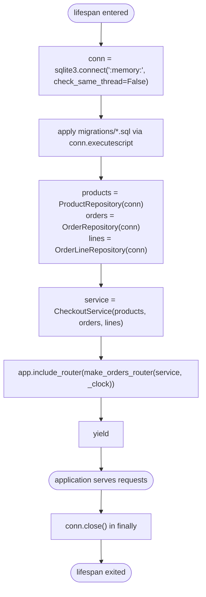
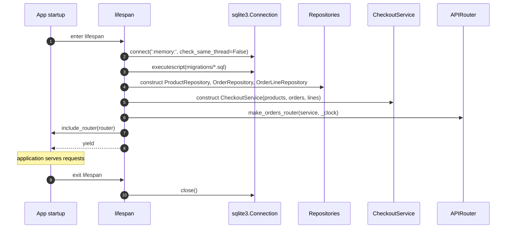

# Task

- task_id: 006_main
- target: main.py
- target_test: main_test.py

# Goal

Wire the whole application at module scope: build the three repositories, the checkout service, and the orders router inside a startup lifecycle; open one in-memory connection on startup and close it on shutdown.

# Interfaces

```python
def _clock() -> str:
    """Return the current UTC time as an ISO-8601 string.

    Description:
        Default clock passed to the orders router factory.
        Returns the current UTC timestamp as a string with the
        timezone offset, e.g. "2024-01-01T00:00:00+00:00".

    Returns:
        str: Current UTC time, ISO-8601 formatted with offset.
    """
    ...


@asynccontextmanager
async def lifespan(app: FastAPI) -> AsyncIterator[None]:
    """Manage the application lifecycle.

    Description:
        Open one shared in-memory connection, apply the schema,
        build the three repositories, the checkout service, and
        the orders router on startup; close the connection on
        shutdown. The shutdown path runs even when startup fails
        after the connection was opened.

    Steps:
        1. On startup, open one shared connection to `:memory:`,
           configured so it can be used from any thread.
        2. Apply the schema to that connection.
        3. Build the three repositories over the connection.
        4. Build the checkout service over the three
           repositories.
        5. Attach exactly one router to the application, closed
           over the service and the clock.
        6. Yield control so the application serves requests.
        7. On shutdown, close the shared connection inside a
           finalizer that runs even when startup fails after the
           connection was opened.

    Raises:
        sqlite3.Error: Whatever the schema loader raises during
            startup. Propagated unchanged.
        Exception: Whatever the framework raises during startup.
            Propagated unchanged.
    """
    ...


app: FastAPI = FastAPI(
    title="Shop",
    version="0.1.0",
    lifespan=lifespan,
)
```

# Activity



# Sequence



# Scenarios

## app starts and applies schema

```gherkin
Given the application module and its lifespan
When the lifespan is entered via a test client context manager
Then the storage catalog contains the tables products, orders, order_lines
And reading an unknown order returns 404
```

## routes are registered

```gherkin
Given the application module and its lifespan
When the lifespan is entered via a test client context manager
Then the application's route table contains exactly one route under /orders
```

## connection closed on shutdown

```gherkin
Given the shared connection is recorded when opened
When the lifespan is entered and exited via a test client context manager
Then the recorded connection has been closed exactly once
```

## each lifespan opens a fresh database

```gherkin
Given the application module and its lifespan
When two separate test client context managers each enter and exit the lifespan
Then the two connections are distinct objects
And neither connection sees rows written through the other
```