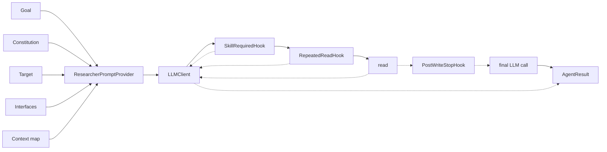
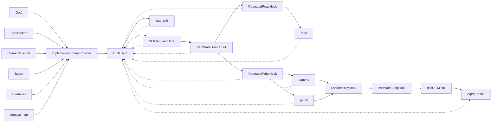
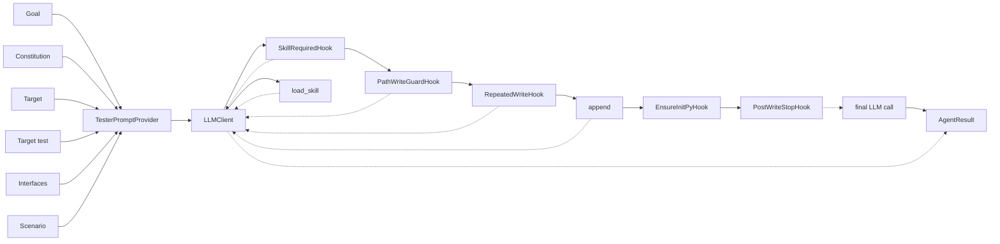
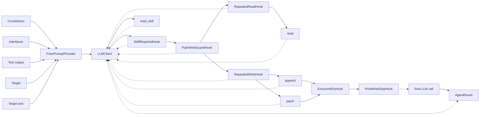

# Agents

Four specialized classes in `agents/`: `ResearcherAgent`, `ImplementerAgent`, `TesterAgent`, `FixerAgent`. Each has its own constructor, its own `run(...)` signature, and its own `PromptProvider` protocol.

[← back to README](../README.md)

## Session

Each agent runs a single loop — up to `max_iterations` LLM calls with `prompt_provider` and the role's tools. Tool calls pass through hooks. A reply with no tool calls → `DONE`. Exhausted budget → `FAILED`.

At each iteration the model receives two messages: the **system prompt** and the **rendered user message**. Both feed the skill choice:

- The **system prompt** contains a `# Skills` section — rendered by `prompt_provider.format_system(skills)`, where `skills` is the list passed to the agent's constructor. One line per skill: `<name>: <description>`. Only skills listed under the role in `AGENT.yaml` appear there. If the role has no skills, the section is absent.
- The **user message** contains the task itself: `# Goal`, `# Context map`, `# Target`, `# Interfaces`, `# Scenario`, `# Test output`, `# History` — depending on the role.

The model reads both messages, matches the task described in the user message against the skill descriptions in `# Skills`, and decides which skills are relevant. For each, it calls `load_skill(name)`. The tool returns the skill body, which lands in `# History` and becomes part of the working context. After the needed skills are loaded, the model continues the same loop with `read` / `append` / `patch`.

If the role has no skills (`Researcher` in the default config), there is no `# Skills` section and no `load_skill` tool — the model never uses it.

## Hooks

A hook is a callable that inspects a tool call before or after execution. There are two kinds:

**Pre-hooks** (`hooks=`) run **before** `tool.execute` and return `str | None`:

- `None` → the tool runs normally.
- `str` → the tool does **not** run; the string becomes `{"hint": "<str>"}` in the tool message. The model continues next iteration.

Four pre-hooks exist:

- `SkillRequiredHook(skills=(...))` — returns a hint if `read` / `append` / `patch` is called before at least one `load_skill` succeeded. Mechanically enforces the `MANDATORY` rule from `# Skills` when the model ignores it. Disabled automatically when `skills=[]`.
- `PathWriteGuardHook(paths=(...))` — returns a hint if `append`/`patch` targets a path **not** in the allowed set. Blocks the write before the filesystem is touched.
- `RepeatedReadHook` — returns a hint if the same `read` path was already read or already failed.
- `RepeatedWriteHook` — returns a hint if the same `append`/`patch` path was already written.

**Post-hooks** (`post_hooks=`) run **after** `tool.execute` and return `None` or raise `StopError`:

- `None` → the tool result is appended to history, the loop continues (or the next post-hook runs).
- `StopError` → see [StopError flow](#stoperror-flow).

Two post-hooks exist:

- `EnsureInitPyHook(root=...)` — after a successful `append`/`patch` of a `.py` file, creates an empty `__init__.py` in the file's directory and every parent up to `root`. Makes `from repositories.products import ProductRepository` resolvable without requiring the spec to declare `__init__.py` files.
- `PostWriteStopHook(paths=(...))` — raises `StopError` after a successful `append`/`patch` to one of the watched paths.

Pre-hooks are checked in order; the first `str` short-circuits the rest. Order matters:

1. `SkillRequiredHook` first — a "load skills first" hint is more useful than "path not allowed" for a model that skipped the mandatory step.
2. `PathWriteGuardHook` second — a "not allowed" hint is more useful than "already written" for a path that should never be touched.
3. `RepeatedReadHook` / `RepeatedWriteHook` last — they guard against duplicate calls after the call is already allowed by the earlier hooks.

Post-hooks are also ordered: `EnsureInitPyHook` runs **before** `PostWriteStopHook` — the `__init__.py` must be created before `PostWriteStopHook` raises `StopError` and ends the session.

`PostWriteStopHook` is wired to **all four agents** uniformly — the constructor signature is the same, the wiring in `commands/*.py` is the same. For the researcher it never fires: the researcher has no `append` / `patch` in its tool list, so the post-hook has nothing to trigger on. The hook sits in the list ready if the researcher ever gains a write tool. The uniform wiring removes a per-role special case and keeps the constructor shape identical across all four classes.

`EnsureInitPyHook` is wired only to **implementer**, **tester**, and **fixer** — the three roles that write files. The researcher never writes, so there is nothing to wrap with `__init__.py`.

## StopError flow

When a post-hook raises `StopError`, the agent does **not** return `DONE` immediately. It performs one more LLM call to produce the final report, then returns `DONE`:

1. Append the tool result to `history` — `{"ok": true, ...}` for the successful write.
2. Build **final messages**:
   - `SYSTEM`: `prompt_provider.format_system(self._skills)` — the same system content the main loop used.
   - `USER`: `prompt_provider.format_user(...)` + `prompt_provider.summary_request`.
3. Call `llm.complete(final_messages, tools=[])` — **no tools**. The model cannot call `append`, `patch`, `read`, or `load_skill`. It can only write text.
4. Append the final reply to `history`.
5. Return `AgentResult(status=DONE)`.

The `summary_request` property appends a short suffix to the user message: the write succeeded, `# History` contains it, do not call any tool, produce the final message per `# Final message`. This guarantees that `AgentResult.final_response` — the last assistant message without tool calls — contains a real report, not an empty string left over from the `tool_call` message.

The final LLM call is not counted against `max_iterations`; it always runs exactly once, regardless of how many iterations remain.

## Stopping

Two independent mechanisms, both end the session with `DONE`:

- **Mechanical** — `PostWriteStopHook` fires right after a successful write to the target, triggering the [StopError flow](#stoperror-flow). The main loop does not continue. The model gets exactly one more turn — a tool-free summary request — and the session ends.
- **Prompt-driven** — the model emits a reply with no tool calls. Each role's system prompt has `# Stop condition` and `# Final message`. Used when no write is needed.

The mechanical path is the primary safety net: it does not depend on the model reading or obeying `# Stop condition`. The model cannot slip in another tool call after a successful write — the post-hook fires, the final turn is tool-free, `DONE`.

## Summary

| Role | `# Skills` in system prompt | User message sections | Tools | Pre-hooks | Post-hooks | Budget |
|---|---|---|---|---|---|---|
| **Researcher** | — | `# Constitution`, `# Context map`, `# Goal`, `# Target`, `# Interfaces`, `# History` | `read` | `SkillRequiredHook`, `RepeatedReadHook` | `PostWriteStopHook(target)` | 10 |
| **Implementer** | yes | `# Constitution`, `# Context map`, `# Goal`, `# Target`, `# Interfaces`, `# Research tasks`, `# History` | `read`, `append`, `patch`, `load_skill` | `SkillRequiredHook`, `PathWriteGuardHook(target)`, `RepeatedReadHook`, `RepeatedWriteHook` | `EnsureInitPyHook`, `PostWriteStopHook(target)` | 30 |
| **Tester** | yes | `# Constitution`, `# Goal`, `# Target`, `# Target test`, `# Test function`, `# Interfaces`, `# Scenario`, `# History` | `append`, `load_skill` | `SkillRequiredHook`, `PathWriteGuardHook(target_test)`, `RepeatedWriteHook` | `EnsureInitPyHook`, `PostWriteStopHook(target_test)` | 15 |
| **Fixer** | yes | `# Constitution`, `# Interfaces`, `# Target`, `# Target test`, `# Test output`, `# History` | `read`, `append`, `patch`, `load_skill` | `SkillRequiredHook`, `PathWriteGuardHook(target, target_test)`, `RepeatedReadHook`, `RepeatedWriteHook` | `EnsureInitPyHook`, `PostWriteStopHook(target, target_test)` | 10 |

## Researcher

## Implementer

## Tester

## Fixer

## `AgentResult`

| Field | Meaning |
|---|---|
| `status` | `DONE` or `FAILED` |
| `messages` | full session history |
| `metrics` | one entry per LLM call, including the final report call |
| `ok` | `True` iff `DONE` |
| `final_response` | last assistant message without tool calls — the report produced by the final LLM call |

`TaskRunner` reads `final_response` from the researcher as `research_report`. `ok` gates every stage transition. For implementer, tester, and fixer, `final_response` is the report produced after `StopError`; it is not consumed by `TaskRunner` but is available for logging and debugging. For the researcher, `final_response` is the report produced by the prompt-driven stop.

## History

`history: list[Message]` is a local variable inside `run(...)`. Tool results are stored as:

| Result | Meaning |
|---|---|
| `{"ok": true, "path": ..., "chars": N}` | successful write (`append` or `patch`) |
| `{"content": ...}` | successful read (`read`) or skill body (`load_skill`) |
| `{"error": "..."}` | tool failure — `load_skill` unknown name, `append` bad args, `read` missing file |
| `{"hint": "..."}` | pre-hook blocked the call — `SkillRequiredHook`, `PathWriteGuardHook`, `RepeatedReadHook`, `RepeatedWriteHook` |

`# History` in the user prompt is the only record of prior reads, prior skill loads, and prior writes — there are no separate `# Already read files` or `# Loaded skills` sections.

`SkillRequiredHook` scans `# History` for a successful `load_skill` result (no `"error"` key). If none exists, `read` / `append` / `patch` are blocked with a hint. One successful `load_skill` unlocks all three tools for the rest of the session — the hook does not require loading *every* skill, only at least one, because it cannot mechanically judge which skills are "relevant" to the task.

On `StopError`, the successful tool result is appended first, then the final report reply is appended. The last two messages are always `TOOL({"ok": ...})` followed by `ASSISTANT(report)`.

[← back to README](../README.md)