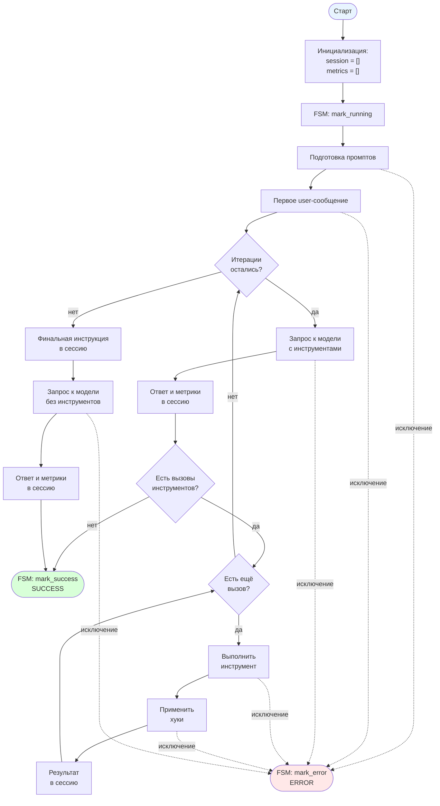

[← Назад к README](../../README.md)

---

# Поток работы агента

## Ключевые моменты

- **FSM управляет статусом агента.** `AgentFSM` живёт в `runners/agent.py` как протокол (`mark_running`, `mark_success`, `mark_error`, `status`) и передаётся в `AgentRunner` через конструктор. Каждый вызов `run` — один цикл `IDLE → RUNNING → SUCCESS | ERROR`.

- **`mark_running` вызывается до `try`.** Если FSM уже в терминальном состоянии — это ошибка вызывающего, и она пробрасывается наружу, а не превращается в `AgentResult(ERROR)`.

- **`mark_success` — в двух точках:** после раннего выхода (модель не запросила инструменты) и после финального запроса (итерации исчерпаны). Обе ведут к `AgentResult(status=SUCCESS)`.

- **`mark_error` — в одном месте:** в `except Exception`. Все исключения (подготовка промптов, вызов модели, выполнение инструмента, хук, финальный запрос) ведут к `AgentResult(status=ERROR)`.

- **`status` в `AgentResult` берётся из FSM.** Это единый источник истины: если передан кастомный FSM (для наблюдаемости или для тестов), статус в результате совпадает с тем, что FSM зафиксировал после последнего перехода.

- **`session` и `metrics` создаются до `mark_running`.** Любое исключение оставляет накопленное состояние в `AgentResult`.

- **Системный промпт добавляется к каждому запросу заново.** В `session` лежат только `USER`, `ASSISTANT` и `TOOL` сообщения; `SYSTEM` конструируется из `format_system(skills)` на каждой итерации.

- **Несколько вызовов инструментов в одном ответе модели** выполняются последовательно, в порядке следования. Для каждого: выполнение → цепочка хуков (результат каждого становится входом следующего) → добавление результата в `session` с `tool_call_id`.

- **Метрики** — по одному набору на каждый запрос к модели, включая финальный.

- **После исчерпания итераций** в `session` добавляется `USER`-сообщение с `final_user`, модель вызывается с `tools=[]`, ответ попадает в `session` и `metrics`, возвращается `SUCCESS`-результат.

- **`max_iterations = 0`.** Цикл не выполняется ни разу, управление сразу уходит на финальный запрос без инструментов, FSM проходит `IDLE → RUNNING → SUCCESS` без промежуточных итераций.

- **Хуки применяются только после выполнения инструментов в основном цикле.** Финальный запрос модель получает с пустым списком инструментов, хуки на него не влияют.

---

[Назад к README](../../README.md)