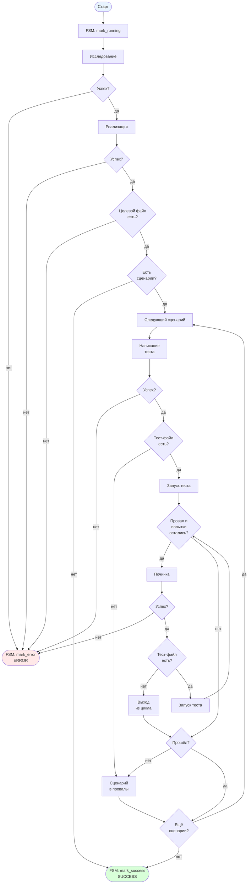

[← Назад к README](../../README.md)

---

# Поток выполнения задачи

## Ключевые моменты

- **FSM управляет статусом задачи.** `TaskFSM` живёт в `runners/task.py` как протокол (`mark_running`, `mark_success`, `mark_error`, `status`) и передаётся в `TaskRunner` через конструктор. Один вызов `run` — один цикл `IDLE → RUNNING → SUCCESS | ERROR`.

- **`mark_running` вызывается до создания `State`.** Если FSM уже в терминальном состоянии — ошибка вызывающего, исключение пробрасывается наружу.

- **`mark_success` — одна точка:** после цикла по сценариям. Даже если часть сценариев провалена, задача завершается `SUCCESS`.

- **`mark_error` — пять источников:** researcher вернул `ERROR`, implementer вернул `ERROR`, целевой файл не создан, tester вернул `ERROR`, fixer вернул `ERROR`. В каждом случае в `results` лежат результаты всех вызовов до этого момента.

- **`status` в `TaskResult` берётся из FSM.** Единый источник истины — `fsm.status` после последнего перехода.

- **Пустой список сценариев.** После успешного researcher/implementer и проверки целевого файла задача сразу завершается `mark_success` → `SUCCESS`.

- **Итоговый `SUCCESS` при проваленных сценариях.** Проваленные сценарии складываются в `failed_gherkins`, цикл переходит к следующему. После цикла — `mark_success`. Список `failed_gherkins` собирается во время выполнения и в возвращаемый результат не попадает.

- **Лимит попыток починки.** Для одного сценария — не более `max_fix_attempts` вызовов fixer. При `max_fix_attempts = 0` починка не вызывается: один прогон теста и переход к следующему сценарию.

- **Что видит fixer.** Перед каждым вызовом починки в `state.test_result` кладётся последний проваленный результат теста: на первой итерации — результат первичного прогона, на второй — результат после предыдущей починки.

- **Имя тест-функции** выводится из имени сценария (нижний регистр, не-буквенные символы — в подчёркивания) и кладётся в `state.test_function` до вызова tester.

- **Исчезновение тест-файла.** Если после tester файл не создан — сценарий сразу уходит в `failed_gherkins` без прогона теста. Если файл исчезает во время цикла починки — цикл прерывается, сценарий уходит в `failed_gherkins`.

- **Сводки ролей.** После каждой роли её ответ кладётся в `state`: `researcher_summary`, `implementer_summary`, `tester_summary`. Fixer читает `tester_summary` из состояния.

- **Накопление результатов.** Каждый вызов агента (researcher, implementer, tester, fixer) добавляет `AgentResult` в общий список `results`, в порядке вызовов.

- **Общее состояние.** `State` конструируется один раз из `Task` (`goal`, `target_file`, `target_test_file`, `declares`, `interfaces`, `constitution`, `sequence`) и мутирует по ходу выполнения.

---

[Назад к README](../../README.md)