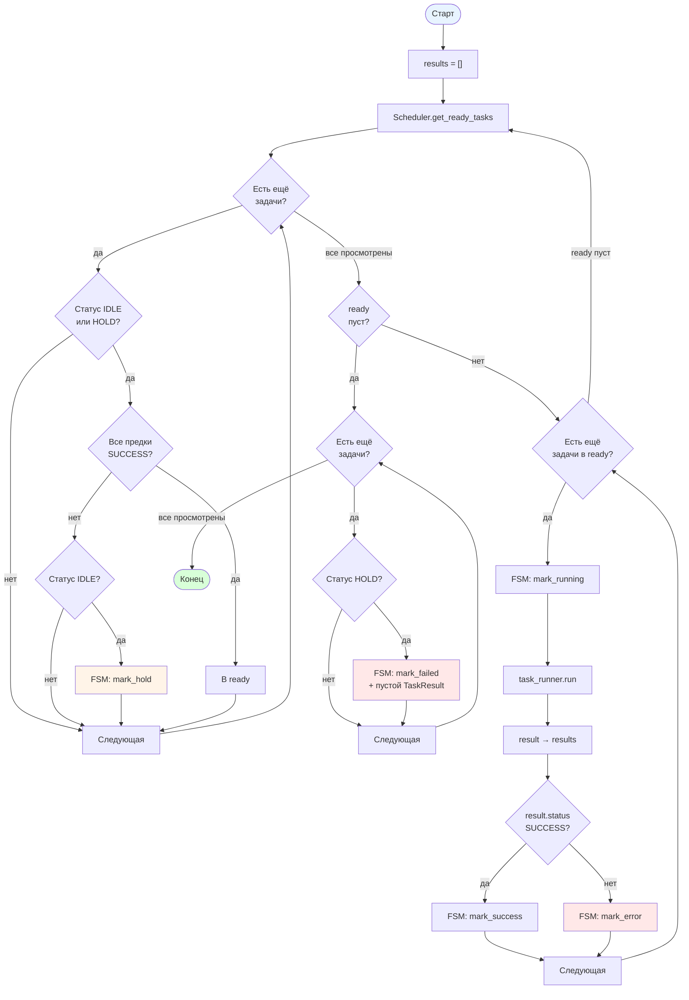

[← Назад к README](../../README.md)

---

# Поток выполнения workflow

## Ключевые моменты

- **Две зоны ответственности.** `Scheduler` вычисляет готовые задачи и переводит `IDLE → HOLD` через `WorkflowFSM.mark_hold`. `WorkflowRunner` запускает готовые и управляет их статусами через `mark_running` / `mark_success` / `mark_error`.

- **Скан в `Scheduler`.** Пропускает задачи не в `IDLE` и не в `HOLD`. Для каждой готовой к рассмотрению проверяет, все ли предки в `SUCCESS`. Если да — задача попадает в `ready`. Если нет и задача в `IDLE` — переходит в `HOLD`. Задачи, уже находящиеся в `HOLD`, не переводятся повторно.

- **`Scheduler` не переводит потомков упавших задач в `ERROR`.** Если предок в `ERROR`, потомок остаётся в `HOLD` — это его финальное состояние на время выполнения workflow.

- **`WorkflowRunner` запускает готовые.** Для каждой задачи из `ready`: `mark_running` → `task_runner.run` → результат в `results` → `mark_success` при `result.status is TaskStatus.SUCCESS`, иначе `mark_error`.

- **Финальный шаг при пустом `ready`.** `WorkflowRunner` проходит по всем задачам, у которых статус `HOLD`, переводит их через `mark_failed` в `ERROR` и добавляет пустой `TaskResult(ERROR)` в `results`. Цикл завершается.

- **`mark_failed` — единственный переход `HOLD → ERROR`.** Семантически отличается от `mark_error` (`RUNNING → ERROR`, собственный провал задачи). Разделение зафиксировано в `WorkflowFSM`.

- **`result.status` вместо `result.ok`.** Агрегаты `ok`/`success`/`error` — не часть модели. `WorkflowRunner` смотрит напрямую на `TaskStatus.SUCCESS`.

- **Волна — один проход внешнего цикла.** `Scheduler.get_ready_tasks` → запуск готовых → повторный `Scheduler.get_ready_tasks`. Количество итераций зависит от глубины DAG.

- **Последовательное выполнение.** Задачи из `ready` запускаются друг за другом; `ready` вычисляется заново на каждом проходе.

- **Порядок результатов.** Сначала результаты текущей волны (в порядке `ready`), затем следующей. Ошибки `mark_failed` добавляются в самом конце, в порядке `workflow.tasks`.

- **Возврат.** `WorkflowResult(results=results)` — все накопленные `TaskResult`.

---

[Назад к README](../../README.md)