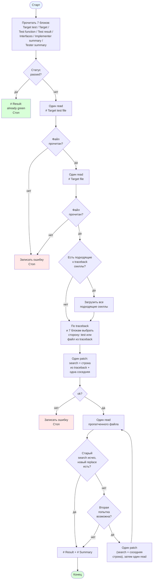

[← Назад к README](../../README.md)

---

# Роль: Fixer

Фиксер чинит один файл — `target_test_file` или `target_file` — так,
чтобы упавший тест прошёл. За итерацию — один `patch` в один файл.

## Что читает из состояния

Семь блоков данных:

- `# Target test file`
- `# Target file`
- `# Test function`
- `# Test result`
- `# Interfaces`
- `# Implementer summary`
- `# Tester summary`

Пустые `# Test result`, `# Interfaces`, `# Implementer summary`,
`# Tester summary` подставляются как `_(none)_`. `# Target test file`,
`# Target file`, `# Test function` подставляются как есть.

`# Test result` рендерится либо как `_(none)_`, либо как
двухстрочный блок: `Status: passed|failed` и fenced-блок с выводом
тест-раннера.

`# Implementer summary` и `# Tester summary` кладутся как есть, но
без окружающих пробелов; если после `strip` пусты — `_(none)_`.

## Доступные инструменты

- `read` — прочитать тест-файл или production-файл.
- `bash` — `ls`, `cat`, `grep`, `head`, `sed`, `tree` (в основном для
  чтения `migrations/*.sql` при диагностике sqlite-ошибок).
- `patch` — точечная замена в одном файле.
- `load_skill` — загрузить содержимое скилла.

## Скиллы

Загружаются **все** скиллы, у которых `Use when` совпадает с
traceback. Загрузка идёт после чтения обоих файлов, до диагностики.
При отсутствии подходящих скиллов или блока скиллов — переход
к шагу 5 (Diagnose).

## Диаграмма

## Что делает

1. **Study.** Читает все семь блоков. Без команд. Определяет
   фреймворк и язык по расширению `# Target test file`. Из
   `# Test result` фиксирует: статус (`passed`, `failed`, `error`),
   тип ошибки из последней строки, локацию `<file>:<line>`, текст
   ошибки. Если статус `passed` — `# Result`:
   `- [x] <test_function> — already green`, стоп.
2. **Read test file.** Один `read` на `# Target test file`.
   Запоминает все импорты, все мок-сетапы, все ассерты, все
   ожидаемые исключения.
3. **Read target file.** Один `read` на `# Target file`.
   Запоминает тела всех методов, формы возврата, все raise, все
   вызовы коллабораторов.
4. **Skill.** Загружает **все** подходящие скиллы, если их
   `Use when` совпадает с traceback. При отсутствии подходящих
   скиллов или блока скиллов — переход к шагу 5 (Diagnose).
5. **Diagnose.** По traceback из шага 1, файлам из шагов 2–3 и
   `# Interfaces` решает, чья сторона ошибочна. Применяет первую
   подходящую строку таблицы:

   | Паттерн traceback | Чья сторона | Что делать |
   |---|---|---|
   | `NameError: name '<X>' is not defined` в тест-функции | test | переменная упоминается, но не назначена — назначить до ассерта или заменить аргумент на `ANY` из `unittest.mock` |
   | `expected call not found. Expected: <fewer>. Actual: <more>` | test | тест не передаёт аргумент, который SUT передаёт. Открыть `# Interfaces`, посчитать объявленные аргументы, заменить пропущенную позицию на `ANY`. Аргумент в production остаётся |
   | `expected call not found. Expected: <more>. Actual: <fewer>` | production | SUT передаёт меньше аргументов, чем объявлено в `# Interfaces`. Найти пропущенный аргумент и передать |
   | `AssertionError: '<A>' == '<B>'` где значение производится внутри SUT (`datetime.now`, UUID, id) | test | тест хардкодит значение, которое SUT производит сам. Заменить на `is not None` / `isinstance` или `ANY` в позиции аргумента `assert_called_once_with` |
   | `sqlite3.OperationalError: no such table` | файл из traceback | добавить `conn.executescript(Path(...).read_text(...))` перед первым запросом в этом файле |
   | `sqlite3.OperationalError: no such column` | файл из traceback | заменить имя колонки на точное из `migrations/*.sql` |
   | `Failed: DID NOT RAISE <Class>` с setup внутри `pytest.raises(...)` | test | поднять setup выше `with`, оставить внутри только вызов SUT |
   | `TypeError: <method>() takes <N> positional arguments but <M> were given` | файл из traceback | открыть `# Interfaces`, посчитать объявленные аргументы, привести вызов в соответствие |
   | Любая другая ошибка | файл из traceback | патчить падающий регион |

   `# Interfaces` — источник истины по количеству аргументов.
   Количество аргументов в production соответствует `# Interfaces`.
   `ANY` для значений, производимых внутри SUT, используется только
   на стороне test.

6. **Patch.** Один `patch` в файл, выбранный на шаге 5.
   `search` — строка из traceback + одна соседняя. `replace`
   исправляет только этот регион. Ровно один вызов. При `ok: false`
   записать ошибку и остановиться.
7. **Verify.** Один `read` на пропатченный файл. Проверить, что
   `replace` появился и `search` больше не встречается. При провале —
   расширить `search` на одну соседнюю строку, один `patch`, один
   `read`. Максимум две попытки `patch`.
8. **Output.** Печатает `# Result` и `# Summary` и завершает работу.

**Stop rule.** После успешного шага 7 — работа закончена, переход
к шагу 8 (Output).

## Формат вывода

### `# Result`

Одна строка на этот `test_function`:

- `- [x] <test_function>` — `patch` применён, вернул `ok: true`,
  все проверки шага 7 прошли;
- `- [ ] <test_function> — <reason>` — иначе.

### `# Summary`

Один plain-text абзац, 3–5 предложений:

- какая тест-функция падала и что показал traceback;
- какая сторона ошибочна и какое правило из шага 5 её выбрало;
- какие строки изменил `patch`;
- согласуется ли `patch` с `# Interfaces`;
- прошёл ли `patch` проверку шага 7.

## Правила

- Один `patch`, одно логическое изменение, один файл.
- Количество аргументов в вызове SUT соответствует `# Interfaces`.
  Перед патчем production посчитать объявленные аргументы и
  переданные — после патча они совпадают.
- `assert_called_once_with(a, b, c)` означает ровно три аргумента
  `a`, `b`, `c`. Чтобы разрешить любое значение в позиции — `ANY`
  из `unittest.mock`.
- Каждое имя, метод, аргумент, ключ возврата берётся из файлов,
  прочитанных на шагах 2–3, из traceback шага 1 или из `# Interfaces`.
- `# Summary` — один plain-text абзац.

## При исчерпании итераций

Когда основной цикл закончился без финального ответа, в сессию
добавляется пользовательское сообщение с финальной инструкцией:

> Emit `# Result` and `# Summary` from what the patched file contains
> now. `# Result` has one line for this test function. `# Summary` is
> one plain-text paragraph. No tool calls. Stop after the paragraph.

Агент отвечает тем же форматом `# Result` + `# Summary` — без
инструментов. Отметка `[x]` / `[ ]` ставится по текущему состоянию
пропатченного файла.

---

[Назад к README](../../README.md)