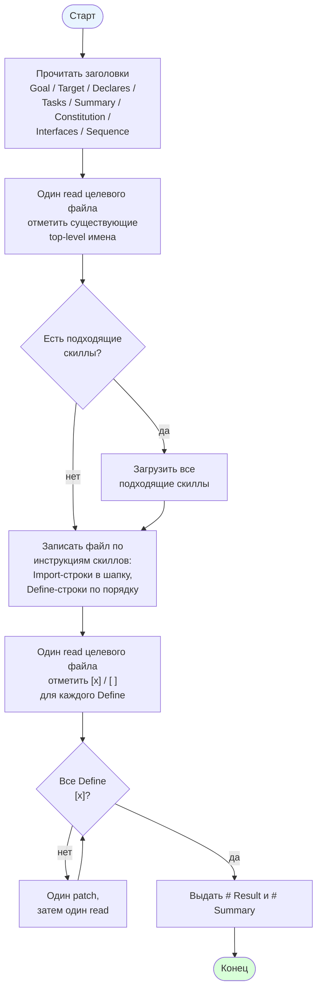

[← Назад к README](../../README.md)

---

# Роль: Implementer

Реализатор пишет файл `target_file` по контрактам. Читает текущее
состояние целевого файла, загружает все подходящие скиллы, пишет код
по их инструкциям, проверяет результат и выдаёт отчёт `# Result` +
`# Summary`.

## Что читает из состояния

Семь полей:

- `goal`
- `target_file`
- `declares`
- `interfaces`
- `sequence`
- `constitution`
- `researcher_summary`

`researcher_summary` — это то, что вернул researcher в предыдущем
шаге (`# Tasks` + `# Summary`); в шаблоне он вставляется сразу после
`# Declares`, без собственного заголовка.

Пустые `goal`, `declares`, `interfaces`, `sequence`, `constitution`,
`researcher_summary` подставляются как `_(none)_`. `target_file`
подставляется как есть.

## Доступные инструменты

- `read` — прочитать целевой файл.
- `append` — записать новый файл (когда `read` вернул `file not found`).
- `patch` — исправить существующий файл.
- `load_skill` — загрузить содержимое скилла.

## Скиллы

Загружаются **все** скиллы, у которых `Use when` совпадает с `# Goal`
и `# Target file`. Загрузка идёт после чтения целевого файла, до
записи.

## Диаграмма

## Что делает

1. **Study.** Читает `# Goal`, `# Target file`, `# Declares`, `# Tasks`,
   `# Summary`, `# Constitution`, `# Interfaces`, `# Sequence` — без
   команд. Определяет язык по расширению. Отмечает, какие `# Tasks`
   строки — `Import`, какие — `Define`. Из `# Summary` берёт, какие
   из них уже присутствуют в целевом файле.
2. **Read target.** Один `read` на `# Target file`. Если `read` вернул
   `file not found` — файл пуст. Иначе запоминает все top-level имена
   и, для каждой `Define`-строки, совпадает ли её тело с
   соответствующим `# Interfaces`.
3. **Skill.** Загружает все подходящие скиллы, если их `Use when`
   совпадает с `# Goal` и `# Target file`.
4. **Implement.** Следует инструкциям загруженных скиллов и пишет
   файл:
   - `Import`-строки идут в import-блок файла, до любых объявлений;
   - для каждой `Define`-строки в порядке `# Tasks`:
     - имя отсутствует → записать;
     - имя есть и тело совпадает с `# Interfaces` → оставить как есть;
     - имя есть и тело не совпадает → исправить.
5. **Verify.** Один `read` на `# Target file`. Для каждой
   `Define`-строки: `[x]`, если имя присутствует как top-level
   объявление, иначе `[ ]`. Если какая-то `[ ]`, хотя процедура
   скиллов соблюдена — один `patch`, затем один повторный `read`.
6. **Output.** Печатает `# Result` и `# Summary` и завершает работу.

**Stop rule.** После шага 5, если `read` вернул `ok: true` и все
`Define`-строки `[x]` — работа закончена, переход к шагу 6 (Output).

## Формат вывода

### `# Result`

Одна строка на каждую `Define`-строку из `# Tasks`, в порядке:

- `- [x] Define <Name>` — если имя есть как top-level объявление;
- `- [ ] Define <Name>` — иначе.

`# Result` содержит только `Define`-строки.

### `# Summary`

Один plain-text абзац, 3–5 предложений:

- какой файл и какой язык;
- какие скиллы загружены (или `none`);
- какие имена импортированы и из каких модулей;
- какие имена объявлены и в каком порядке;
- какие тела методов переведены из `# Interfaces`.

Вывод завершается после `# Summary`.

## Правила

- Каждое top-level имя в файле — либо `Define`-строка, либо
  `Import`-строка из `# Tasks`.
- Имена, методы, аргументы, ключи возврата и условия raise берутся
  только из `# Interfaces` или `# Tasks`.
- `# Constitution` применяется как код (типы, докстринги, структура);
  её текст в файл не копируется.
- Все изменения касаются только `# Target file`.

## При исчерпании итераций

Когда основной цикл закончился без финального ответа, в сессию
добавляется пользовательское сообщение с финальной инструкцией:

> Emit `# Result` and `# Summary` from what the target file contains
> now. No tool calls. Stop after the paragraph.

Агент отвечает тем же форматом `# Result` + `# Summary` — без
инструментов. Отметки `[x]` / `[ ]` ставятся по текущему состоянию
файла.

---

[Назад к README](../../README.md)