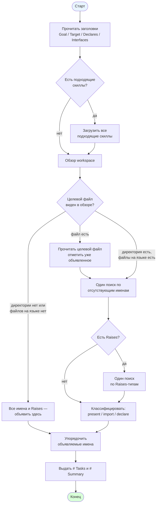

[← Назад к README](../../README.md)

---

# Роль: Researcher

Исследователь изучает задачу и контракты, выполняет ограниченный
набор инструментов для проверки уже существующих объявлений и
формирует чек-лист `# Tasks` и сводку `# Summary`.

## Что читает из состояния

Четыре поля:

- `goal`
- `target_file`
- `declares`
- `interfaces`

Пустые `goal`, `declares`, `interfaces` подставляются как `_(none)_`.
`target_file` подставляется как есть.

## Доступные инструменты

- `bash` — `ls`, `cat`, `grep`, `head`, `sed`, `tree`.
- `read` — прочитать файл целиком.
- `load_skill` — загрузить содержимое скилла.

## Скиллы

Загружаются **все** скиллы, у которых `Use when` совпадает с `# Goal`
и `# Target file`. Загрузка идёт после чтения заголовков, до обзора
workspace.

## Диаграмма

## Что делает

1. **Читает заголовки** `# Goal`, `# Target file`, `# Declares`,
   `# Interfaces` без вызова инструментов.
2. **Загружает все подходящие скиллы** — те, у которых `Use when`
   совпадает с `# Goal` и `# Target file`.
3. **Один обзор workspace** с исключением `.git` и `__pycache__`.
   Если `tree` недоступен — рекурсивный `ls` (один раз).
4. **Проверяет целевой файл по обзору:**
   - файл есть → один `read`, отметить уже объявленные имена и
     совпадение тел с интерфейсами;
   - директория есть, файлы на целевом языке есть → файл новый,
     ни одно имя не «already present»;
   - директории нет или в ней нет файлов целевого языка → все имена
     «объявить здесь», все Raises-типы «объявить здесь», переход
     к шагу 8.
5. **Один поиск** по объединению отсутствующих имён `# Declares`
   (альтернатива `|`), с фильтром по расширению языка. Исключает
   `tasks/`, `skills/`, `migrations/`, `workflows/`, `__pycache__/`,
   `AGENT.md`, `AGENT.yaml`.
6. **Один опциональный поиск** по Raises-типам, если в `# Interfaces`
   есть хотя бы один блок Raises.
7. **Классифицирует** каждое имя `# Declares`:
   - уже в целевом файле → «present in target»;
   - объявлено в другом файле и это контракт (interface, protocol,
     abstract class) или тип ошибки → «import from»;
   - объявлено в другом файле и это данные (model, enum, DTO,
     record) → «объявить здесь»;
   - упомянуто или не найдено → «объявить здесь».
   
   Каждый Raises-тип: объявлено в другом файле → «import from»,
   иначе → «объявить здесь».
8. **Упорядочивает** «объявить здесь»: базовые ошибки → производные →
   контракты → данные → верхнеуровневый компонент. При равенстве
   сохраняет порядок `# Declares`.
9. **Печатает** `# Tasks` и `# Summary` и завершает работу.

**Stop rule.** После шага 4 в случае «директории нет / нет файлов
на языке» — переход к шагу 8. После шага 6 — переход к шагам
7 (Decide), 8 (Order) и 9 (Output), которые выполняются без
bash-вызовов.

## Формат вывода

`# Tasks` содержит только действия для implementer:

- `- [ ] Create the file <target>` — если файла нет;
- `- [ ] Replace the file <target>` — если файл есть;
- `- [ ] Import <Name> from <module>` — на каждое «import from»;
- `- [ ] Define <Name>` — на каждое «объявить здесь», в порядке.

Имена, уже объявленные в целевом файле, в чек-лист попадают только
как no-op для implementer и в `# Tasks` не включаются.

`# Summary` — один абзац plain-text, 3–5 предложений: существовал
ли целевой файл и какие имена в нём уже были; какие имена надо
импортировать и откуда; какие надо объявить и в каком порядке; какие
существующие файлы патчатся задачей.

Вывод завершается после `# Summary`.

## При исчерпании итераций

Когда основной цикл закончился без финального ответа, в сессию
добавляется пользовательское сообщение с финальной инструкцией:

> Emit `# Tasks` and `# Summary` from what you recorded. `# Summary`
> is one plain-text paragraph. No tool calls. Stop after the paragraph.

Агент отвечает тем же форматом `# Tasks` + `# Summary` — без
инструментов. Имена, по которым шаг не был выполнен, помечаются как
«объявить здесь» / «not found».

---

[Назад к README](../../README.md)