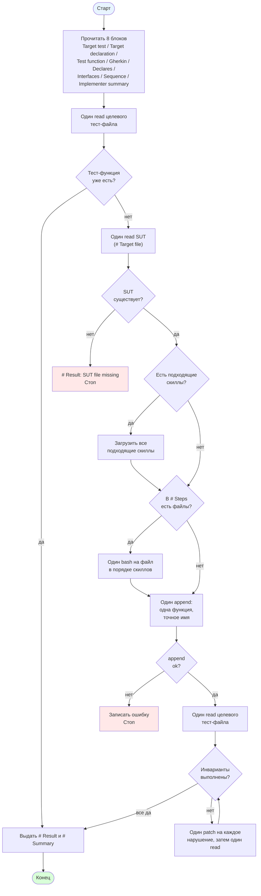

[← Назад к README](../../README.md)

---

# Роль: Tester

Тестировщик превращает один Gherkin-сценарий в одну тест-функцию
и записывает её в целевой тест-файл.

## Что читает из состояния

Восемь блоков данных:

- `# Target test file`
- `# Target declaration`
- `# Test function`
- `# Gherkin`
- `# Declares`
- `# Interfaces`
- `# Sequence`
- `# Implementer summary`

Пустые `# Target declaration`, `# Declares`, `# Interfaces`,
`# Sequence`, `# Gherkin`, `# Implementer summary` подставляются как
`_(none)_`. `# Target test file` и `# Test function` подставляются
как есть.

## Доступные инструменты

- `read` — прочитать целевой тест-файл (и SUT, по шагу 3).
- `bash` — `ls`, `cat`, `grep`, `head`, `sed`, `tree`. Используется
  только если `# Steps` скиллов ссылаются на файлы (схемы, фикстуры,
  соседние тест-модули).
- `append` — записать новую тест-функцию.
- `patch` — исправить найденные нарушения инвариантов.
- `load_skill` — загрузить содержимое скилла.

## Скиллы

Загружаются **все** скиллы, у которых `Use when` совпадает с
`# Target declaration`, `# Test function` и `# Gherkin`. Загрузка
идёт после чтения SUT, до записи теста.

## Диаграмма

## Что делает

1. **Study.** Читает все восемь блоков. Без команд. Определяет
   фреймворк и язык по расширению `# Target test file`. Определяет
   тип сценария — happy path или failure path — по ключевым словам
   Gherkin. Для failure path фиксирует точный тип из `Raises:`.
   Отмечает, какие имена `# Implementer summary` называет уже
   существующими в целевом файле.
2. **Read test file.** Один `read` на `# Target test file`.
   Запоминает все имена тест-функций. Если `# Test function` уже
   присутствует — переход к шагу 7.
3. **Read SUT.** Один `read` на `# Target file`. Запоминает
   параметры конструктора, сигнатуры методов, все raise, все ключи
   возврата, все вызовы коллабораторов. Если `read` вернул
   `file not found` — `# Result`: `- [ ] <scenario name> — SUT file
   missing`, стоп.
4. **Skill.** Загружает все подходящие скиллы, если их `Use when`
   совпадает с `# Target declaration`, `# Test function` и
   `# Gherkin`.
5. **Test.** Следует инструкциям загруженных скиллов и пишет тест.
   Если `# Steps` скиллов ссылаются на файлы (схемы, фикстуры,
   соседние тест-модули), читает их одним `bash`-вызовом на файл,
   в порядке скиллов, до append. Один `append` — одна законченная
   тест-функция с точным именем из `# Test function`. При `ok: false`
   записывает ошибку и останавливается.
6. **Verify.** Один `read` на `# Target test file`. Проверяет три
   инварианта:
   - имя функции встречается в файле ровно один раз;
   - для failure path assert на raise называет точный тип из `Raises:`;
   - для happy path assert формы возврата использует ключи из
     `Returns:`.
   
   При провале любого инварианта — один `patch` на каждое нарушение,
   затем один `read` для подтверждения.
7. **Output.** Печатает `# Result` и `# Summary` и завершает работу.

**Stop rule.** После шага 6 с `ok: true` — работа завершена,
переход к шагу 7 (Output).

## Формат вывода

### `# Result`

Одна строка на этот сценарий:

- `- [x] <scenario name>` — функция в файле и все проверки шага 6
  прошли;
- `- [ ] <scenario name> — <reason>` — иначе.

### `# Summary`

Один plain-text абзац, 3–5 предложений:

- какой сценарий;
- какие скиллы загружены (или `none`);
- что тест выстраивает (arrange);
- какой единственный When-вызов;
- что проверяют ассерты;
- точный тип ошибки для failure path.

## Правила

- Один `append`, одна функция, один сценарий. Имя функции — ровно
  `# Test function`, скопированное дословно.
- Каждый мок, фикстура и ассерт берутся из `# Gherkin`,
  `# Interfaces`, исходника SUT и `# Steps` скиллов.
- Все изменения касаются только `# Target test file`.
- `# Summary` — один plain-text абзац.

## При исчерпании итераций

Когда основной цикл закончился без финального ответа, в сессию
добавляется пользовательское сообщение с финальной инструкцией:

> Emit `# Result` and `# Summary` from what the target test file
> contains now. `# Result` has one line for this scenario.
> `# Summary` is one plain-text paragraph. No tool calls. Stop after
> the paragraph.

Агент отвечает тем же форматом `# Result` + `# Summary` — без
инструментов. Отметка `[x]` / `[ ]` ставится по текущему состоянию
файла.

---

[Назад к README](../../README.md)