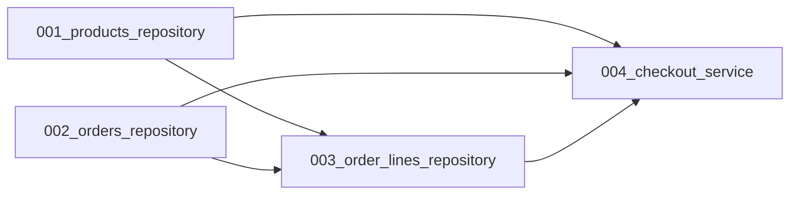

# Specification

A specification is the project's complete contract: engine config, constitution, workflow graph, tasks, skills. Every artifact the engine reads is parsed and validated before any agent runs.

[← back to README](../README.md)

## Layout

```text
project/
├── AGENT.md
├── AGENT.yaml
├── skills/<skill_name>/SKILL.md
├── tasks/<task_id>.md
└── workflows/<workflow_name>.md
```

## `AGENT.md` — constitution

Free-form markdown. The pipeline loads this file once per command run and injects its full text into every agent's user message as `# Constitution`. Every prompt provider renders this section verbatim — the text is opaque to the engine, the engine only passes it through.

Purpose: project-wide rules that apply to every file. The stack, the migration directory, the comment conventions, the tracing conventions. Every rule here overrides any conflicting instruction elsewhere — the `# Rules` section of a skill, the `# Interfaces` block of a task, the model's general knowledge.

The file is required. `init` reports `exists` / `missing`. The run pipeline reads it before any agent starts; a missing file is a startup error.

## `AGENT.yaml` — engine config

Top-level keys:

- **`max_fix_attempts`** — optional, non-negative integer. How many times `TaskRunner` re-runs the failing test after a fix. Default `3`.
- **`repomap`** — required mapping. One key: `max_tokens`, a positive integer that bounds the `# Context map` block. Required — no default.
- **`agents`** — required mapping with four sub-keys: `researcher`, `implementer`, `tester`, `fixer`. Every missing role is a startup error.

Each role has one required key and three optional ones:

- **`provider`** — required mapping with four required fields: `base_url`, `api_key`, `model`, `temperature`. Only `temperature` is forwarded to the model call; any other key is ignored.
- **`tools`** — optional list. Every name must be one of `read`, `append`, `patch`, `load_skill`. Unknown names raise `ValueError("unknown tool: ...")`. Default `[]`.
- **`skills`** — optional list of skill names. Every name must exist in `skills/<name>/SKILL.md` — a missing name raises `ValueError("skills not found: [...]")` before any agent is built. Default `[]`.
- **`max_iterations`** — optional positive integer. Cap for the main agent loop. Default `15`.

````yaml
max_fix_attempts: 3

repomap:
  max_tokens: 2000

agents:
  researcher:
    provider:
      base_url: http://192.168.50.236:8080/v1
      api_key: none
      model: Qwen3-Coder-30B-A3B-Instruct-Q4_K_M
      temperature: 0.3
    tools:
      - read
    max_iterations: 10

  implementer:
    provider:
      base_url: http://192.168.50.236:8080/v1
      api_key: none
      model: Qwen3-Coder-30B-A3B-Instruct-Q4_K_M
      temperature: 0.3
    tools:
      - read
      - append
      - patch
      - load_skill
    skills:
      - python-developer
      - sqlite-implementing
    max_iterations: 30
````

## How skills reach the model

The role's `skills` list is rendered into the **system prompt** by `PromptProvider.format_system(skills)` as a `# Skills` section — one line per skill, `<name>: <description>`. The section is present only when `skills` is non-empty. The **user message** carries the task — goal, context map, target, interfaces, scenario, history — but no skill catalog.

The model reads both messages, matches the task against the skill descriptions in `# Skills`, and calls `load_skill(name)` for each skill it needs. The tool returns the skill body, which lands in `# History` and becomes part of the working context. After the needed skills are loaded, the model continues with `read` / `append` / `patch`.

`SkillRequiredHook` blocks `read` / `append` / `patch` until at least one `load_skill` call has succeeded. A model that skips the mandatory load step gets a hint instead of a tool result, and the loop continues — the block is a hint, not a failure. If the role's `skills` list is empty, the hook is disabled automatically, and `load_skill` is not in the role's tool list.

## `workflows/<workflow_name>.md` — graph

One ` ```mermaid ` block. The first non-blank line is `graph <direction>` where direction is one of `LR`, `RL`, `TD`, `TB`, `BT` (case-insensitive). Nodes are task ids matching `[A-Za-z0-9_]+`, edges are `source --> target`. Multiple edges may be chained on one line: `a --> b --> c`. Standalone node ids declare nodes without edges. No cycles, no orphans.

````markdown

````

## `tasks/<task_id>.md` — task

Exactly four top-level `# ` sections, in this order. Any missing section, extra section, or wrong order is a parse error.

### `# Task`

Bullet fields, one per line: `- key: value`. Three are required:

- **`task_id`** — unique identifier, matching the filename.
- **`target`** — workspace-relative path of the implementation file.
- **`target_test`** — workspace-relative path of the test file.

Extra fields are ignored.

### `# Goal`

A single sentence — the acceptance criterion for the whole task.

### `# Interfaces`

One fenced code block per symbol. The fence's language tag reflects the target language — ```python, ```go, ```rust, ```typescript, ```java, or any other. The language tag is **not** validated; the block is treated as opaque text and rendered back to the model exactly as written.

The block's body becomes `Interface.content` and is passed to the implementer verbatim.

The symbol name is taken from the first top-level declaration inside the block — whatever keyword the language uses: `class`, `def`, `func`, `type`, `interface`, `struct`, `trait`, `fn`, `impl`. The engine does not parse the block; the name is read as the first word after the declaration keyword.

Example with Python:

````markdown
```python
class ProductRepository:
    """Read/write access to the products table."""

    def get(self, product_id: str) -> dict | None:
        ...
```
````

Example with Go:

````markdown
```go
type ProductRepository struct {
    conn *sql.DB
}

func (r *ProductRepository) Get(productID string) (map[string]any, error) {
    // ...
}
```
````

### `# Scenarios`

One `## <scenario name>` sub-header per test. Each sub-header is followed by a ` ```gherkin ` fence with steps starting with `Given`, `When`, `Then`, or `And`. `And` extends the previous step group. Every scenario must have at least one `given`, one `when`, one `then`.

The Gherkin language is fixed — it is a test DSL, not the target language. The step text inside the fence is free-form and describes behaviour, not code.

````markdown
# Scenarios

## Get returns dict

```gherkin
Given an empty product store
When calling `ProductRepository.get("p1")`
Then the result is a `dict`
```
````

Full example with all four sections:

`````markdown
````markdown
# Task

- task_id: 001_products_repository
- target: repositories/products.py
- target_test: repositories/products_test.py

# Goal

Define `ProductRepository` over the `products` table.

# Interfaces

```python
class ProductRepository:
    """Read/write access to the products table."""

    def get(self, product_id: str) -> dict | None:
        ...
```

# Scenarios

## Get returns dict

```gherkin
Given an empty product store
When calling `ProductRepository.get("p1")`
Then the result is a `dict`
```
````
`````

## `skills/<skill_name>/SKILL.md` — skill

YAML frontmatter with `name` and `description`, then a markdown body. Every file is parsed with `parse_skill` and validated with `validate_skill` at startup.

The validated catalog is filtered per role by that role's `skills` list. The filtered list is passed to two places:

1. **`PromptProvider.format_system(skills)`** — renders the `# Skills` section in the role's system prompt.
2. **`LoadSkillTool(skills=...)`** — resolves `load_skill(name)` calls from the model.

The same list backs both. The model can only load a skill whose name and description it saw in `# Skills`; a name not in the list is not in `LoadSkillTool`’s dictionary, and `load_skill` raises `ValueError: unknown skill`.

````markdown
---
name: python-developer
description: Base-layer rules for every Python module.
---

# Python developer

## Imports

Builtins are never imported.
````

[← back to README](../README.md)