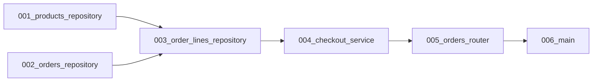

[← Назад к README](../README.md)

---

# Граф задач

Workflow — DAG из задач, где узел — `task_id`, ребро `A → B` означает
«B запускается после успешного завершения A». Harness разбивает DAG на
волны по готовности: волна — все узлы, у которых все предки в `SUCCESS`.
Задачи внутри волны независимы друг от друга; текущая реализация
запускает их последовательно.

## Эталонный workflow — шесть задач на магазин

## Пять волн

1. `001_products_repository`, `002_orders_repository` — независимые корни.
2. `003_order_lines_repository` — зависит от обоих репозиториев.
3. `004_checkout_service` — зависит от `003_order_lines_repository`
   (а через неё — транзитивно от `001` и `002`).
4. `005_orders_router` — зависит от сервиса.
5. `006_main` — зависит от роутера.

## Статусы

`Workflow` хранит статус по `task_id`:

- `IDLE` — задача ещё не запускалась.
- `HOLD` — задача ждёт завершения предков.
- `RUNNING` — задача выполняется.
- `SUCCESS` — задача завершилась успешно.
- `ERROR` — задача упала сама или получила `ERROR` от предка.

Переходы: корни (и задачи, все предки которых уже `SUCCESS`) идут
`IDLE → RUNNING`; остальные — `IDLE → HOLD → RUNNING`. Из `RUNNING`
задача выходит в `SUCCESS` или `ERROR`.

Если задача падает с `ERROR`, её потомки при следующем сканировании
каскадно помечаются `ERROR` и не попадают в ready-волну. Соседи по
волне продолжают выполнение.

Если очередная волна пуста, а `HOLD`-задачи остались, все они
помечаются `ERROR` — workflow завершается. На корректном DAG этого не
происходит: это защита от зависания на случай несогласованных данных.

---

[Назад к README](../README.md)