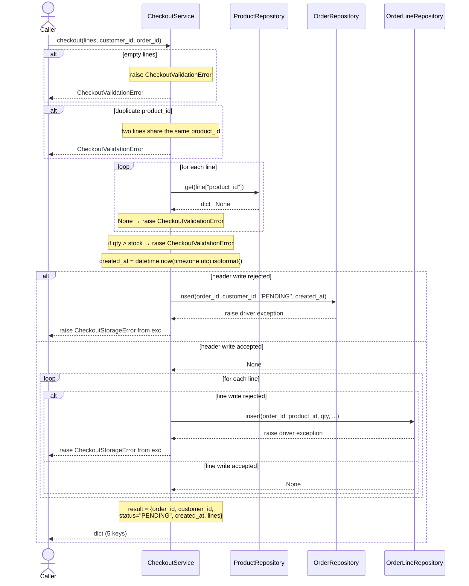

[← Назад к README](../README.md)

---

# Протокол задачи

Задача — `.md`-файл с пятью секциями: `# Task`, `# Goal`, `# Declares`, `# Interfaces`, `# Sequence` (опционально), `# Gherkins`.

## 1. `# Task` — идентификация

Три поля, каждое на отдельной строке:

- `task_id` — уникальный идентификатор задачи;
- `target_file` — путь production-файла;
- `target_test_file` — путь test-файла.

```
# Task

- task_id: 004_checkout_service
- target_file: services/checkout.py
- target_test_file: services/checkout_test.py
```

## 2. `# Goal` — одна фраза

Одна фраза, формулирующая задачу. Парсер берёт её как `task.goal`.

```
# Goal

Turn a list of order lines into a persisted order; plain-dict API.
```

## 3. `# Declares` — top-level символы файла

Плоский список имён, которые `target_file` объявляет на верхнем уровне. Один символ — одна строка `- <Name>`. Порядок в списке не задаёт порядок объявлений в файле.

```
# Declares

- CheckoutService
- ProductRepository
- OrderRepository
- OrderLineRepository
- CheckoutError
- CheckoutValidationError
- CheckoutStorageError
```

Количество имён в `# Declares` совпадает с количеством fenced block'ов в `# Interfaces`.

## 4. `# Interfaces` — контракты

Один fenced code block на каждый символ из `# Declares`. Соответствие — по имени top-level символа внутри фенса, не по позиции. Language tag фенса — язык production-файла, одинаковый у всех фенсов.

Каждый контракт содержит:

- сигнатуру с типами;
- docstring с `Description`, `Steps`, `Returns`, `Raises` (где применимо).

`Steps` фиксирует порядок и side effects. Пример для `CheckoutService.checkout`:

```
Steps:
    1. Raise CheckoutValidationError when the lines list is empty,
       before any repository call.
    2. Raise CheckoutValidationError when any two lines share the
       same product_id — this check runs before the product
       repository is touched.
    3. Look up the product for each line; raise
       CheckoutValidationError when no product matches.
    4. Raise CheckoutValidationError when any line's quantity
       exceeds its product's stock.
    5. Produce created_at via datetime.now(timezone.utc).isoformat().
    6. Persist the order header. Wrap storage rejection in
       CheckoutStorageError via raise ... from exc.
    7. Persist every line, in the input order. Wrap storage
       rejection in CheckoutStorageError via raise ... from exc.
    8. Return a dict with exactly five keys — order_id,
       customer_id, status "PENDING", created_at from step 5,
       lines.
```

Коллабораторы (символы из других файлов) в `# Interfaces` не входят — они упоминаются только в сигнатурах и `# Sequence`.

## 5. `# Sequence` — поведенческий контракт (опционально)

Fenced block с `sequenceDiagram` на `mermaid` или `plantuml`. Парсер заполняет `Sequence(language=..., content=...)`.



`# Sequence` фиксирует то, чего нет в `Steps`: порядок `loop`-блоков, `alt`-ветки на ошибках, `Note` как guard. Если ни один символ не вызывает коллабораторов — секции нет, `task.sequence is None`.

## 6. `# Gherkins` — критерии соответствия

Один или несколько сценариев. Каждый сценарий — заголовок и fenced `gherkin` block. Формат заголовка — `## <Declaration>: <scenario name>`, где `<Declaration>` — имя одного из символов `# Declares`, `<scenario name>` — имя сценария.

Парсер связывает сценарий с символом через `<Declaration>` в заголовке. Один и тот же символ может использоваться в нескольких сценариях.

```gherkin
## CheckoutService: checkout persists order and lines

Given an empty shop store with the schema applied
And a product with id "p1" and stock 10 is persisted
And a checkout service over the repositories
And one line for product "p1" with qty 1, unit_amount "10.00", unit_currency "USD"
When checkout is called for customer "c1" and order "o1"
Then the returned mapping has exactly five keys
And its status is "PENDING"
And its created_at is a non-empty ISO-8601 string with a timezone offset
And its lines have one element for product "p1"
And the order header "o1" is persisted
And the line for product "p1" is persisted under order "o1"
    with qty 1, unit_amount "10.00", unit_currency "USD"
```

Каждый `Then` соответствует конкретному пункту контракта:

- `exactly five keys` → `Returns:` блока `CheckoutService.checkout`;
- `status is "PENDING"` → шаг 8;
- `created_at is a non-empty ISO-8601 string` → шаг 5;
- `order header "o1" is persisted` → шаг 6;
- `line for product "p1" is persisted ... qty 1` → шаг 7.

Требования парсера к Gherkin:

- первая строка — `Given` (одна или несколько);
- далее `When` (одна или несколько);
- далее `Then` (одна или несколько);
- `And` продолжает предыдущий блок;
- имя сценария уникально в пределах задачи;
- `<Declaration>` в заголовке присутствует в `# Declares`.

Tester транслирует Gherkin в `def test_...()` без изменения assertions. Fixer чинит код, а не тест.

---

[Назад к README](../README.md)