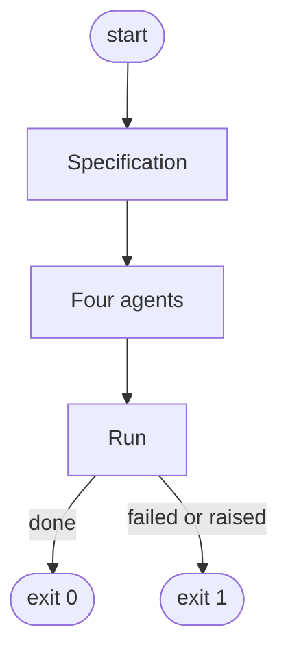
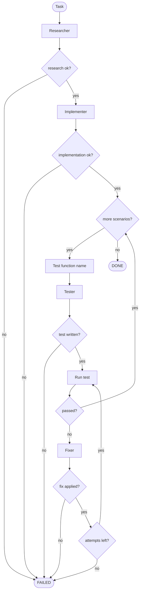
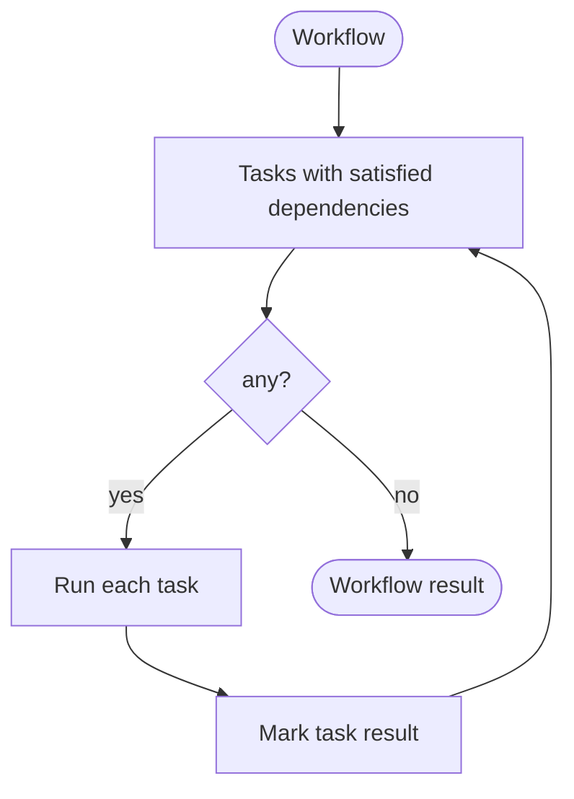
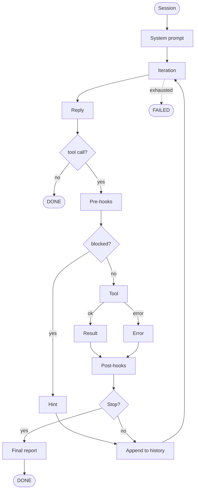

# Workflow

How the engine executes a specification. Four layers: the CLI command, the workflow walk, the task pipeline, and one agent session.

[← back to README](../README.md)

## 1. Top-level process

The specification is the project's complete contract: `AGENT.md`, `AGENT.yaml`, `skills/*/SKILL.md`, `tasks/*.md`, `workflows/*.md`. Every artifact is parsed and validated before any agent runs. The four roles — researcher, implementer, tester, fixer — are built from the role blocks in `AGENT.yaml`. Each role's `skills` list is resolved against the parsed catalog and passed to the role's prompt provider, its `LoadSkillTool`, and its `SkillRequiredHook` — all three see the same list. `AGENT.md` is read once and passed to every agent as `constitution`.

`RunTaskCommand.execute` and `RunWorkflowCommand.execute` are self-contained. `main.py` is the CLI dispatcher and imports only `commands`.

## 2. Task pipeline

The researcher studies the workspace and produces a research report. The implementer writes the target file from that report. For every scenario, the test function name is computed once, the tester writes the test with that exact name, the test is run, and on failure the fixer is given one chance to change either the target or the test. The fix loop is bounded by `max_fix_attempts`. The same test function name is used in the tester call and in every test run inside the fix loop — no recomputation, no drift.

`TaskRunner` is stateless between tasks. `AgentResult.final_response` from the researcher is the only content the pipeline forwards. Each agent maintains its own `history` locally inside `run(...)` — nothing is shared between roles.

## 3. Workflow walk

The workflow walks the graph batch by batch. A task becomes ready only after every parent task is `DONE`. A `FAILED` parent blocks its dependents — they never become ready, so the result contains exactly the tasks that ran. Each task's result is marked before the next batch is computed.

## 4. Agent session

Each agent runs a single loop. Skill loading happens inside the same loop — the model calls `load_skill(name)` the same way it calls `read` or `append`. There is no separate selection phase.

| Aspect | Behaviour |
|---|---|
| **System prompt** | built once per session from the role's prompt provider and the role's skills. Contains `# Skills` only when the skills list is non-empty. Reused unchanged for the final report call. |
| **Loop** | up to `max_iterations` model calls with the role's tools. |
| **Loop exit** | reply without a tool call → `DONE`. The `# Stop condition` and `# Final message` in the system prompt guide the model toward this. |
| **Pre-hooks** | run before the tool, in registration order. First non-`None` return becomes a hint in history and the tool is skipped. |
| **Post-hooks** | run after the tool, in registration order. Each may return `None` (continue) or raise `StopError`. |
| **Status** | `DONE` on exit by prose, or after `StopError`; `FAILED` on exhausted `max_iterations`. |
| **`final_response`** | last assistant message without tool calls; `""` if none. |
| **`history`** | local to the session. Prompt providers render `# History` from it; hooks parse it. |
| **Tool errors** | serialized into a tool message; the loop continues — the model sees the error on the next turn. |
| **Unknown tool** | serialized into a tool message; loop continues. |

## 5. Stop flow

When a post-hook raises `StopError`, the session does **not** end immediately. The agent makes one more model call to produce the final report, then ends the session:

1. Append the successful tool result to history.
2. Build final messages: the same system prompt, and the user message plus `summary_request`.
3. Call the model with **no tools**.
4. Append the final reply to history.
5. End the session with `DONE`.

The final call is not counted against `max_iterations`; it always runs exactly once. `summary_request` tells the model the write succeeded, history contains it, do not call any tool, produce the final message per `# Final message`. `final_response` therefore contains a real report, not the empty `content` left over from the tool call.

## 6. Hooks

A hook is a callable that inspects a tool call before or after execution. There are two kinds.

### Pre-hooks

- **Before the tool.**
- **`None`** → the tool runs.
- **`str`** → the tool does **not** run; a hint is appended to history, the model continues in the next iteration.
- The first non-`None` short-circuits the rest.

| Pre-hook | Fires on | Returns hint when |
|---|---|---|
| `SkillRequiredHook` | `read`, `append`, `patch` | no successful `load_skill` in history yet. Disabled automatically when the role's skills list is empty. |
| `PathWriteGuardHook` | `append`, `patch` | the path is not in the allowed set |
| `RepeatedReadHook` | `read` | the path already in history as a successful read or a failed read |
| `RepeatedWriteHook` | `append`, `patch` | the path already written successfully in history |

### Post-hooks

- **After the tool.**
- **`None`** → the result is appended to history, the loop continues (or the next post-hook runs).
- **Raises `StopError`** → the result is appended to history, the session enters the [Stop flow](#5-stop-flow).

| Post-hook | Fires on | Raises `StopError` when |
|---|---|---|
| `EnsureInitPyHook` | `append`, `patch` of a `.py` file | never. Side effect only: creates missing `__init__.py` files up the directory tree. Runs **before** `PostWriteStopHook` so the file exists before the session ends. |
| `PostWriteStopHook` | `append`, `patch` | no error in the result and the path is in the watched set |

### Per-role wiring

Hooks are passed to each agent's constructor in `commands/task.py` and `commands/workflow.py`:

| Role | Pre-hooks | Post-hooks |
|---|---|---|
| **Researcher** | `SkillRequiredHook`, `RepeatedReadHook` | `PostWriteStopHook(target)` |
| **Implementer** | `SkillRequiredHook`, `PathWriteGuardHook(target)`, `RepeatedReadHook`, `RepeatedWriteHook` | `EnsureInitPyHook`, `PostWriteStopHook(target)` |
| **Tester** | `SkillRequiredHook`, `PathWriteGuardHook(target_test)`, `RepeatedWriteHook` | `EnsureInitPyHook`, `PostWriteStopHook(target_test)` |
| **Fixer** | `SkillRequiredHook`, `PathWriteGuardHook(target, target_test)`, `RepeatedReadHook`, `RepeatedWriteHook` | `EnsureInitPyHook`, `PostWriteStopHook(target, target_test)` |

Order matters in both lists:

- **Pre-hooks:** `SkillRequiredHook` first (a "load skills" hint is more useful than "path not allowed" for a model that skipped the mandatory step), `PathWriteGuardHook` second, `RepeatedReadHook` / `RepeatedWriteHook` last.
- **Post-hooks:** `EnsureInitPyHook` first — the `__init__.py` must exist before `PostWriteStopHook` raises `StopError`.

For the researcher, `PostWriteStopHook` is wired but never fires — the researcher has no `append` / `patch` in its tool list. The uniform wiring keeps the constructor shape identical across all four classes; if the researcher ever gains a write tool, the hook is ready.

[← back to README](../README.md)